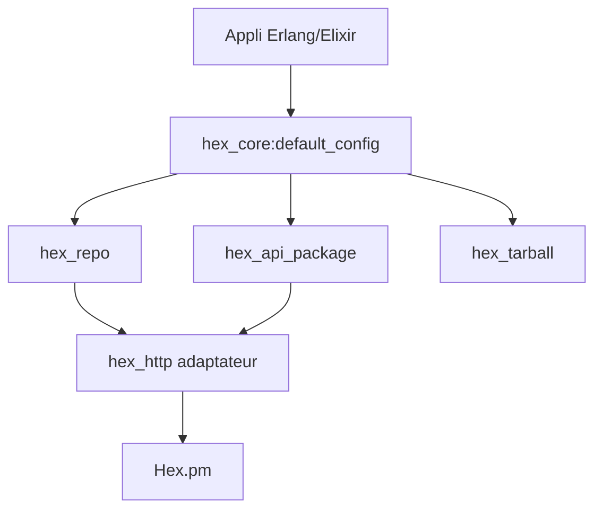

# hexpm/hex_core

> Implémentation de référence des spécifications Hex en Erlang, pour les outils qui parlent au registre Hex.pm.

## Le problème
Parler au dépôt de paquets Hex (liste, versions, tarballs, publication) sans réécrire client HTTP, protobuf et vérification de checksums.

## Ce que ça fait vraiment
Fournit des modules Erlang : `hex_repo` (noms, versions, releases, tarballs), `hex_api_package` (API HTTP, publication), `hex_tarball` (création et dépaquetage avec checksums). Gère le 2FA par TOTP (`api_otp`) et un adaptateur HTTP remplaçable (httpc par défaut). Il est recommandé d'écrire un module enveloppe pour le cache et les erreurs.

## Comment c'est branché


## Essayer
```bash
rebar3 as dev compile
rebar3 as test proper
rebar3 ex_doc
```
Dépendance : `{hex_core, "0.21.1"}` dans `rebar.config`, ou `{:hex_core, "~> 0.21.1"}` dans `mix.exs`.

## Coût et pièges
Gratuit. L'adaptateur httpc vérifie les certificats via `public_key:cacerts_get/0` : les requêtes HTTPS échouent sur OTP 24 sans options `ssl`.

## Ce que ce n'est pas
Pas un gestionnaire de paquets : une brique pour en écrire un. Le cache et la gestion des échecs sont laissés à l'utilisateur.

## Alternatives
Aucune nommée dans le README.

## Pour toi
Ignorer : écosystème Erlang/Elixir, sans lien avec un quotidien data / IA / MLOps, sauf outillage Hex maison.

