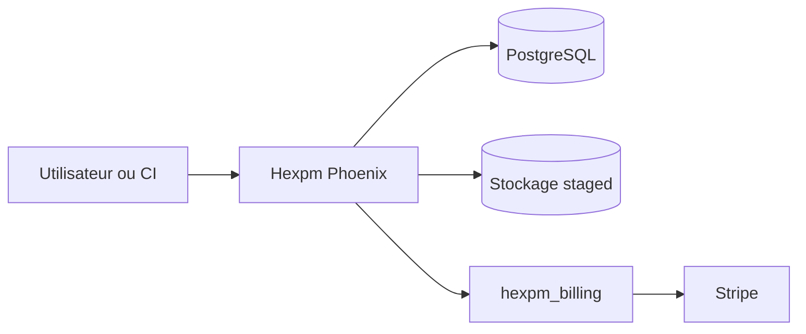

# hexpm/hexpm

> Code for the website and API of the Hex package registry, for those who host it or contribute to it.

## The problem
A package registry needs an API, a website, storage and a safe publishing flow.

## What it actually does
Elixir (Phoenix) application with PostgreSQL (pg_trgm and pgcrypto extensions). It serves the API and the website, geolocates the IPs in the audit log using a DB-IP database, and plugs in billing via Stripe. Staged publishing requires human approval with two-factor authentication, expiring after seven days. An emergency mode enforces it on every public publication.

## How it is wired
Simplified diagram based on the fiche, no diagram provided.


## Trying it
```bash
mix setup
mix test
iex -S mix phx.server
```
Then http://localhost:4000/.

## Cost and gotchas
Docker (for PostgreSQL) and Node for the assets. Integration tests require ChromeDriver, a Stripe sandbox and the hexpm_billing repository. No license is declared.

## What it is not
It is not the `mix hex` client nor a ready-to-host registry: the README covers local development and leaves the site name empty. No license declared.

## Alternatives
No alternative named in the README.

## For you
Ignore: only useful to host or contribute to an Elixir registry; no declared license and outside your data / AI scope.
