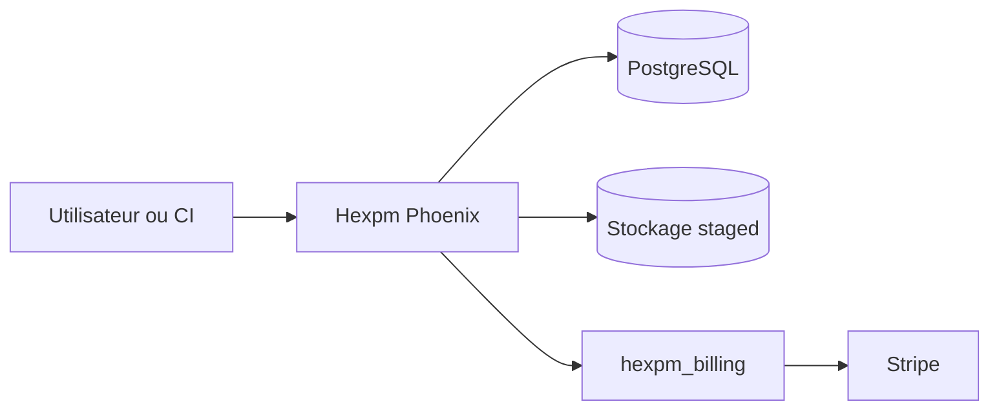

# hexpm/hexpm

> Code du site et de l'API du registre de paquets Hex, pour ceux qui l'hébergent ou y contribuent.

## Le problème
Un registre de paquets a besoin d'une API, d'un site, d'un stockage et d'un circuit de publication sûr.

## Ce que ça fait vraiment
Application Elixir (Phoenix) avec PostgreSQL (extensions pg_trgm et pgcrypto). Elle sert l'API et le site, localise les IP du journal d'audit via une base DB-IP, et branche la facturation via Stripe. La publication par étapes impose une approbation humaine avec double authentification, avec expiration à sept jours. Un mode d'urgence l'impose à toute publication publique.

## Comment c'est branché
Schéma simplifié d'après la fiche, sans diagramme fourni.


## Essayer
```bash
mix setup
mix test
iex -S mix phx.server
```
Puis http://localhost:4000/.

## Coût et pièges
Docker (pour PostgreSQL) et Node pour les assets. Les tests d'intégration exigent ChromeDriver, un bac à sable Stripe et le dépôt hexpm_billing. Aucune licence n'est déclarée.

## Ce que ce n'est pas
Ce n'est pas le client `mix hex` ni un registre prêt à héberger : le README parle de développement local et laisse vide le nom du site. Aucune licence déclarée.

## Alternatives
Aucune alternative nommée dans le README.

## Pour toi
À ignorer : utile seulement pour héberger ou contribuer à un registre Elixir ; sans licence déclarée et hors de ton champ data / IA.

