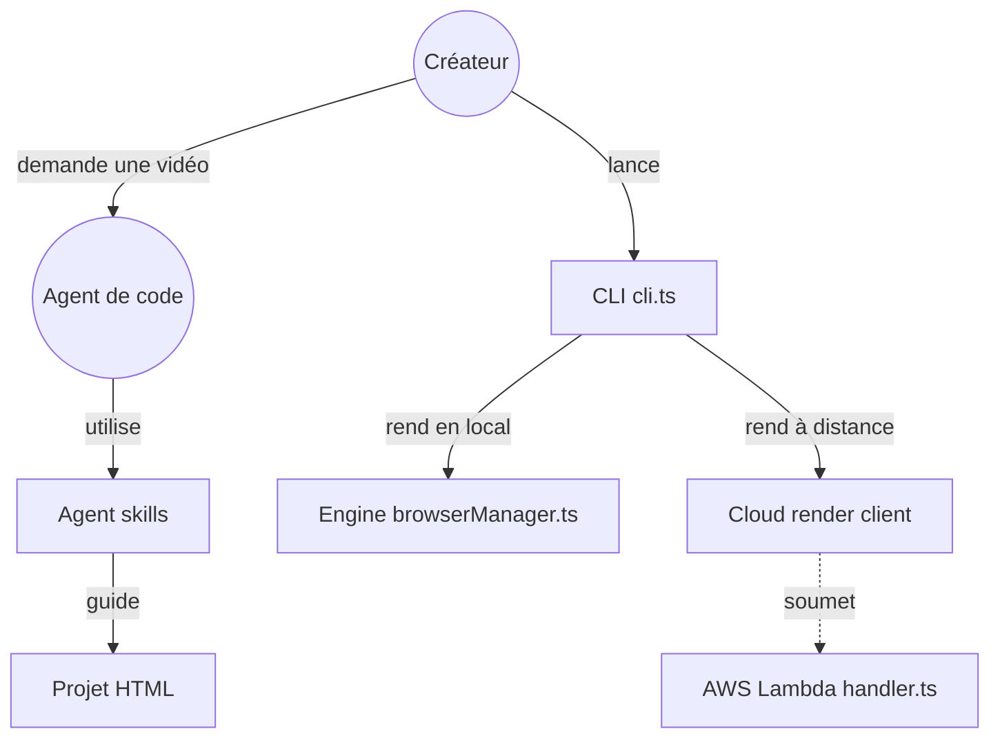

# heygen-com/hyperframes

> A framework that allows for deterministic MP4 video generation from HTML compositions, controlled by a code agent.

## The problem
Creating an animated video requires either a graphic editor or a React project. Developers write HTML, not proprietary timelines.

## What it actually does
The video is described in HTML with attributes `data-start`, `data-duration`, `data-track-index`, along with GSAP, CSS, or Lottie animations. The engine opens Chrome headless, advances image by image, and encodes using FFmpeg: the same input, the same output. It provides a command-line interface, a preview studio, a catalog of approximately 450 blocks, nine skills for agents, and distributed rendering on AWS Lambda.

## How it is wired


## Trying it
```bash
npx hyperframes init my-video
cd my-video
npx hyperframes preview
npx hyperframes render
npx hyperframes skills update
```

## Cost and gotchas
Node.js 22 or later and FFmpeg are required. Image-by-image rendering is CPU and memory-intensive. The Pro package from the studio includes HeyGen's paid models; the core remains Apache-2.0.

## What it is not
This is not an AI video generator: it creates what you describe. The full repository clone weighs approximately 240 MB in MP4 format via Git LFS.

## Alternatives
Remotion: React-based composition, mature cloud-based Lambda rendering, but with a source-available license.

## For you
Keep an eye on this if you are automating data or demonstration videos; the project, which began in March 2026, falls outside the core data/MLOps area.
