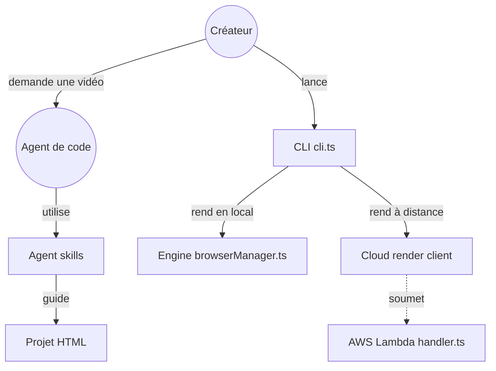

# heygen-com/hyperframes

> Framework qui rend en vidéo MP4 déterministe des compositions HTML, pilotable par un agent de code.

## Le problème
Produire une vidéo animée par programme oblige à un éditeur graphique ou à un projet React. Les agents de code écrivent du HTML, pas des timelines propriétaires.

## Ce que ça fait vraiment
On décrit la vidéo en HTML avec des attributs `data-start`, `data-duration`, `data-track-index`, plus des animations GSAP, CSS ou Lottie. Le moteur ouvre Chrome headless, avance image par image et encode avec FFmpeg : même entrée, même sortie. Il fournit un CLI, un studio de prévisualisation, un catalogue d'environ 450 blocs, neuf skills pour agents et un rendu distribué sur AWS Lambda.

## Comment c'est branché


## Essayer
```bash
npx hyperframes init my-video
cd my-video
npx hyperframes preview
npx hyperframes render
npx hyperframes skills update
```

## Coût et pièges
Node.js 22 ou plus et FFmpeg sont requis. Le rendu image par image est gourmand en CPU et en mémoire. Le forfait Pro du studio ajoute les modèles payants de HeyGen ; le cœur reste Apache-2.0.

## Ce que ce n'est pas
Ce n'est pas un générateur de vidéo par IA : il rend ce qu'on lui décrit. Le clone du dépôt complet pèse environ 240 Mo de MP4 via Git LFS.

## Alternatives
Remotion : composition en React, rendu cloud Lambda plus mûr, mais licence source-available.

## Pour toi
À surveiller si tu automatises des vidéos de données ou de démonstration ; projet né en mars 2026, hors du cœur data/MLOps.

