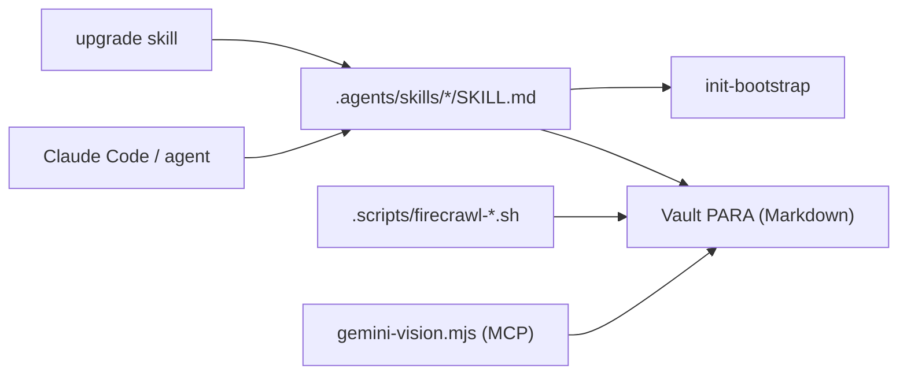

# heyitsnoah/claudesidian

> Preconfigured Obsidian vault with skills for working with Claude Code as a thinking partner.

## The problem
An Obsidian notes vault stays passive: the agent has neither structure nor instructions to search, sort and link ideas in it.

## What it actually does
A Git repository template organized with PARA (00_Inbox to 06_Metadata) and a set of skills in `.agents/skills/` (thinking-partner, inbox-processor, research-assistant, daily-review, upgrade, init-bootstrap…), with mirrors for `.claude/skills/` and `.pi/skills/`. `/init-bootstrap` installs dependencies, customizes `CLAUDE.md` and initializes Git. Options: web capture via Firecrawl, image and PDF analysis via a Gemini MCP server, npm scripts.

## How it is wired


## Trying it
```bash
git clone https://github.com/heyitsnoah/claudesidian.git my-vault
cd my-vault
claude
/init-bootstrap
```

## Cost and gotchas
The base is free; Claude Code is a separate service. Firecrawl (`FIRECRAWL_API_KEY`, 300 free credits to start) and Gemini (`GEMINI_API_KEY`) are optional. The bootstrap may search for your public work, with your permission.

## What it is not
Not an application: there is no server or web interface, only Markdown files and agent instructions. The README recommends reviewing everything the AI writes.

## Alternatives
No alternative named in the README.

## For you
Worth watching: a good example of how to organize skills and CLAUDE.md, to cherry-pick from for your own notes base rather than adopt as is.
