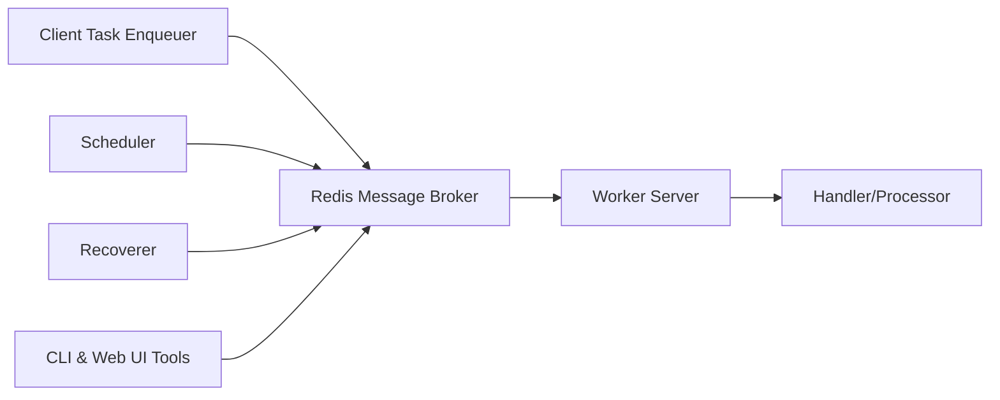

# hibiken/asynq

> Distributed task queue in Go, backed by Redis, with concurrent workers.

## The problem
Move long-running work (emails, resizing, scheduled jobs) out of the request path, with reliable retries.

## What it actually does
The client enqueues tasks (type + payload) into Redis; the server consumes them with one goroutine per task.
At-least-once execution, retries, scheduling, periodic tasks, deduplication, timeouts, grouped aggregation.
Weighted or strict priority queues, middlewares, queue pausing, Redis Sentinel.
Prometheus metrics, Asynqmon web UI, CLI.

## How it is wired


## Trying it
```bash
go get -u github.com/hibiken/asynq
go install github.com/hibiken/asynq/tools/asynq@latest
```

## Cost and gotchas
Free; Redis ≥ 4.0 required, some Lua scripts are incompatible with Redis Cluster. API is v0.x and may break.

## What it is not
Not for Python: Go library only. Not a workflow orchestrator.

## Alternatives
No alternative named in the README.

## For you
Ignore on the Python ML side; worth remembering only if you write Go services that need to offload jobs.
