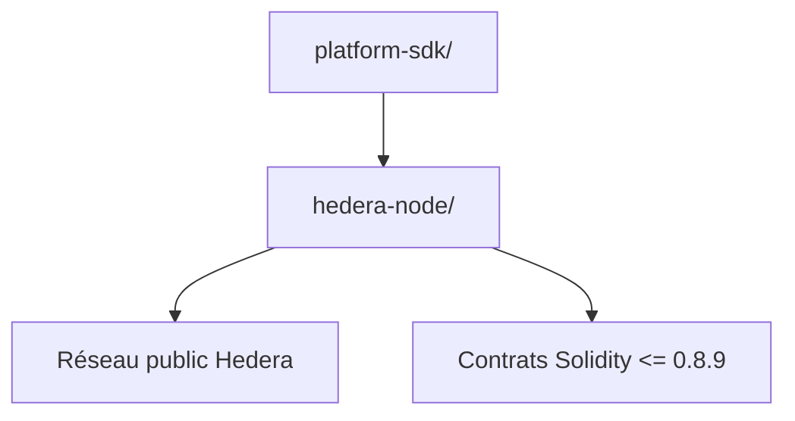

# hiero-ledger/hiero-consensus-node

> Implementation of the platform and services of the nodes of the public Hedera network.

## The problem
A distributed consensus network needs a reference implementation of its nodes.

## What it actually does
The repository contains two modules: `platform-sdk/` (the base platform) and `hedera-node/` (the Hedera services on top of that platform). The README is very brief and points to the architecture, the getting-started guide and the documentation. Solidity contracts are supported up to `pragma solidity <=0.8.9`. The language is not specified in the README.

## How it is wired
Simplified diagram based on the sheet, no diagram provided.

## Trying it
No documented command: the README points to an external getting-started guide.

## Cost and gotchas
Free, but the project is heavy (1,679 open issues) and the README says nothing about build prerequisites. Running a node requires infrastructure that the README does not describe.

## What it is not
It is not an application SDK nor a tool to install for data use: it is the network's node software.

## Alternatives
No alternative named in the README.

## For you
Ignore: blockchain infrastructure implementation, unrelated to data / AI / MLOps work.
