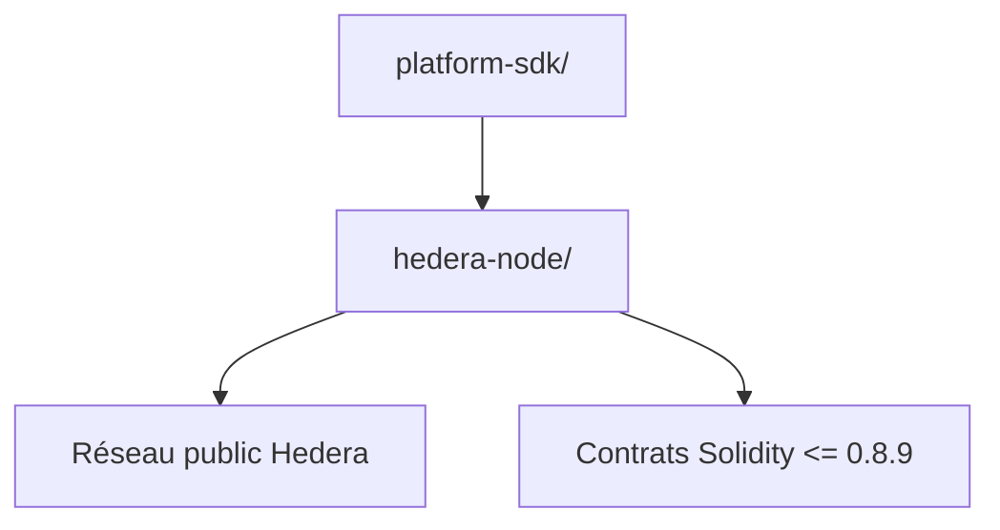

# hiero-ledger/hiero-consensus-node

> Implémentation de la plateforme et des services des nœuds du réseau public Hedera.

## Le problème
Un réseau distribué à consensus a besoin d'une implémentation de référence de ses nœuds.

## Ce que ça fait vraiment
Le dépôt contient deux modules : `platform-sdk/` (la plateforme de base) et `hedera-node/` (les services Hedera sur cette plateforme). Le README est très bref et renvoie vers l'architecture, le guide de démarrage et la documentation. Les contrats Solidity sont pris en charge jusqu'à `pragma solidity <=0.8.9`. Le langage n'est pas précisé dans le README.

## Comment c'est branché
Schéma simplifié d'après la fiche, sans diagramme fourni.

## Essayer
Aucune commande documentée : le README renvoie vers un guide de démarrage externe.

## Coût et pièges
Gratuit, mais le chantier est lourd (1 679 issues ouvertes) et le README ne dit rien des prérequis de compilation. Exploiter un nœud demande une infrastructure que le README ne décrit pas.

## Ce que ce n'est pas
Ce n'est pas un SDK d'application ni un outil à installer pour un usage de données : c'est le logiciel de nœud du réseau.

## Alternatives
Aucune alternative nommée dans le README.

## Pour toi
À ignorer : implémentation d'infrastructure blockchain, sans lien avec un travail data / IA / MLOps.

