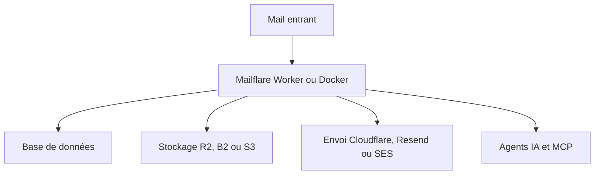

# hieunc229/mailflare

> Self-hosted alternative to Google Workspace: domain email, calendar, drive, booking, AI agents.

## The problem
Hosted office suites lock email, calendar and files in with a single provider.

## What it actually does
Mailboxes on a custom domain with routing rules, calendar, public booking, drive, administration (users, API keys, webhooks, audit, backups) and AI agents (search, drafts, calendar, MCP). Runs on Cloudflare Workers or a Docker container; D1, Postgres, MySQL, Turso or SQLite database; sending via Cloudflare, Resend or Amazon SES.

## How it is wired
Simplified diagram based on the sheet, no diagram provided.



## Trying it
```bash
cp .env.docker.example .env.docker
docker compose up -d --build
```

## Cost and gotchas
Free receiving via Cloudflare Email Routing; free sending with Resend (3,000 mails per month) or SES; Cloudflare sending requires the $5 per month Worker plan. A `CF_TOKEN` token with extended rights is required. The Worker must be named `mailflare`.

## What it is not
Not a complete replacement for Google Workspace (no shared documents or video calls in the README). Repo from May 2026, still young.

## Alternatives
No alternative named in the README.

## For you
Worth watching: interesting for hosting your mail with MCP agents, but young and single-author.
