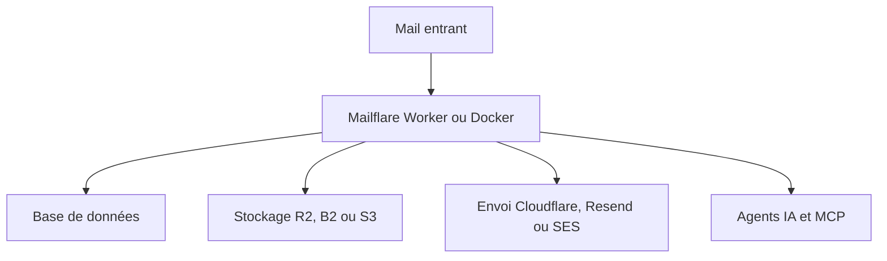

# hieunc229/mailflare

> Alternative auto-hébergée à Google Workspace : e-mail de domaine, agenda, drive, réservation, agents IA.

## Le problème
Les suites bureautiques hébergées enferment e-mail, agenda et fichiers chez un fournisseur unique.

## Ce que ça fait vraiment
Boîtes mail sur domaine personnalisé avec règles de routage, calendrier, réservation publique, drive, administration (utilisateurs, clés d'API, webhooks, audit, sauvegardes) et agents IA (recherche, brouillons, agenda, MCP). Tourne sur Cloudflare Workers ou un conteneur Docker ; base D1, Postgres, MySQL, Turso ou SQLite ; envoi par Cloudflare, Resend ou Amazon SES.

## Comment c'est branché
Schéma simplifié d'après la fiche, sans diagramme fourni.



## Essayer
```bash
cp .env.docker.example .env.docker
docker compose up -d --build
```

## Coût et pièges
Réception gratuite via Cloudflare Email Routing ; envoi gratuit avec Resend (3 000 mails par mois) ou SES ; l'envoi Cloudflare demande le plan Worker à 5 dollars par mois. Un jeton `CF_TOKEN` aux droits étendus est requis. Le Worker doit s'appeler `mailflare`.

## Ce que ce n'est pas
Pas un remplaçant complet de Google Workspace (pas de documents partagés ni visio dans le README). Dépôt de mai 2026, encore jeune.

## Alternatives
Aucune alternative nommée dans le README.

## Pour toi
À surveiller : intéressant pour héberger ta messagerie avec agents MCP, mais jeune et à un seul auteur.

