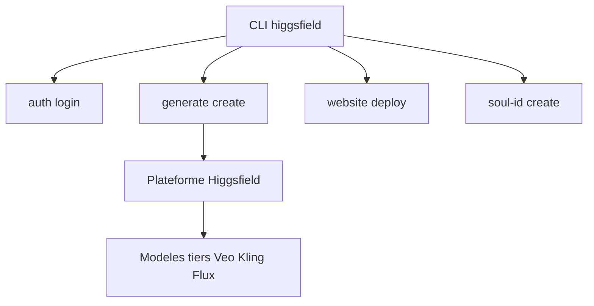

# higgsfield-ai/cli

> Command line to generate images, videos, 3D and audio with more than 40 models hosted by Higgsfield.

## The problem
Using many generative models requires as many different web interfaces and APIs.

## What it actually does
A single `higgsfield` binary sends generation jobs (`generate create`) to the platform and waits for the result with `--wait`. Adds workflows (dubbing, reframing, voice change), Soul ID character training, game and website deployment.

## How it is wired

Simplified diagram based on the fiche, no diagram provided.

## Trying it
```bash
npm install -g @higgsfield/cli
higgsfield auth login
higgsfield generate create nano_banana_2 --prompt "a quiet beach at sunrise" --wait
```

## Cost and gotchas
Higgsfield account required, generation billed in credits (`higgsfield account` for the balance). The model code stays hosted on their side; only the client is open.

## What it is not
Not a local tool: no model runs on your machine. Cost estimates do not exist for `voice-change` and `dubbing`.

## Alternatives
No alternative cited in the README.

## For you
Worth watching: handy for scripting media generation, but everything depends on a paid service from a single company.
