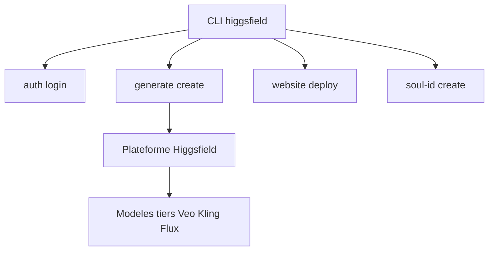

# higgsfield-ai/cli

> Ligne de commande pour générer images, vidéos, 3D et audio avec plus de 40 modèles hébergés par Higgsfield.

## Le problème
Utiliser de nombreux modèles génératifs demande autant d'interfaces web et d'API différentes.

## Ce que ça fait vraiment
Un seul binaire `higgsfield` envoie des jobs de génération (`generate create`) à la plateforme et attend le résultat avec `--wait`. Ajoute des workflows (doublage, recadrage, changement de voix), l'entraînement de personnages Soul ID, le déploiement de jeux et de sites web.

## Comment c'est branché

Schéma simplifié d'après la fiche, sans diagramme fourni.

## Essayer
```bash
npm install -g @higgsfield/cli
higgsfield auth login
higgsfield generate create nano_banana_2 --prompt "a quiet beach at sunrise" --wait
```

## Coût et pièges
Compte Higgsfield requis, génération facturée en crédits (`higgsfield account` pour le solde). Le code des modèles reste hébergé chez eux ; seul le client est ouvert.

## Ce que ce n'est pas
Pas un outil local : aucun modèle ne tourne sur ta machine. Les estimations de coût n'existent pas pour `voice-change` et `dubbing`.

## Alternatives
Aucune alternative citée dans le README.

## Pour toi
À surveiller : pratique pour scripter de la génération média, mais tout dépend d'un service payant d'une seule entreprise.

