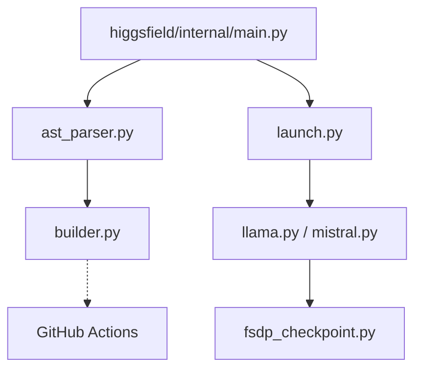

# higgsfield-ai/higgsfield

> GPU orchestration framework for training billion-parameter models across multiple nodes.

## The problem
Launching a multi-node training run requires managing environments, machine access, experiment queues and resumption.

## What it actually does
Installs Docker, deploy keys and a binary on your servers, then generates GitHub Actions workflows that deploy and launch experiments. Supports DeepSpeed's ZeRO-3 and PyTorch's FSDP, an experiment queue and LLaMA and Mistral models. Ubuntu nodes with SSH and passwordless sudo.

## How it is wired


## Trying it
```bash
pip install higgsfield==0.0.3
```
The README shows an example Llama70b training script decorated with @experiment.

## Cost and gotchas
Free, but GPU nodes are at your expense (Azure, LambdaLabs, FluidStack tested). Archived repo, version 0.0.3.

## What it is not
Not a cluster scheduler like Kubernetes nor a managed service. No guaranteed support given the archiving.

## Alternatives
No alternative named in the README.

## For you
Ignore: archived and very early in version; for multi-node training prefer DeepSpeed or FSDP directly.
