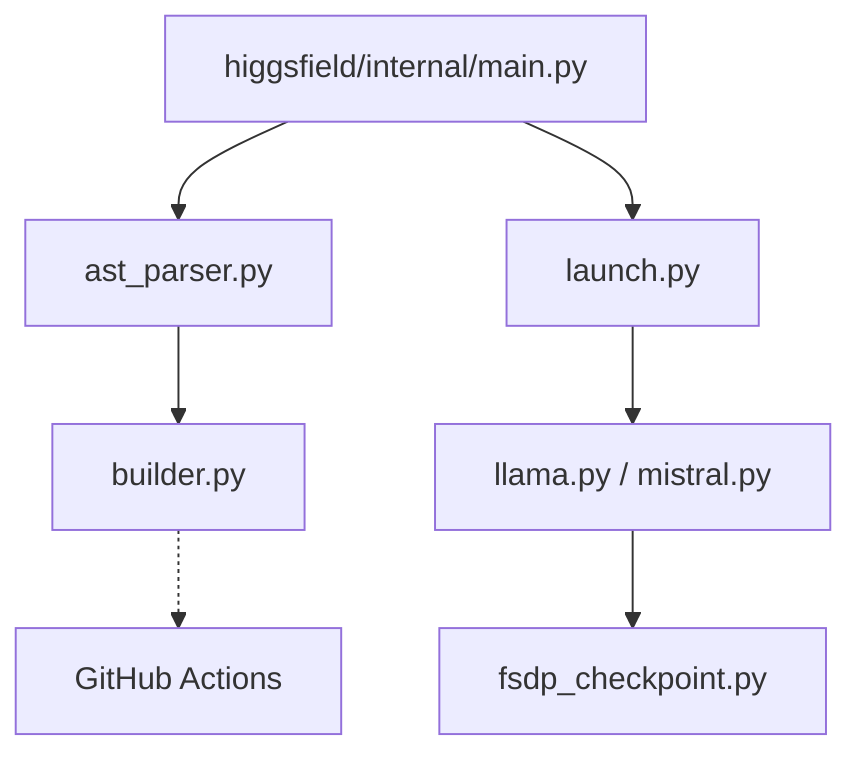

# higgsfield-ai/higgsfield

> Framework d'orchestration de GPU pour entraîner des modèles de milliards de paramètres sur plusieurs nœuds.

## Le problème
Lancer un entraînement multi-nœuds exige de gérer environnements, accès aux machines, files d'expériences et reprise.

## Ce que ça fait vraiment
Installe sur tes serveurs Docker, clés de déploiement et binaire, puis génère des workflows GitHub Actions qui déploient et lancent les expériences. Supporte ZeRO-3 de DeepSpeed et FSDP de PyTorch, une file d'attente d'expériences et des modèles LLaMA et Mistral. Nœuds Ubuntu avec SSH et sudo sans mot de passe.

## Comment c'est branché


## Essayer
```bash
pip install higgsfield==0.0.3
```
Le README montre un exemple de script d'entraînement Llama70b décoré par @experiment.

## Coût et pièges
Gratuit, mais nœuds GPU à ta charge (Azure, LambdaLabs, FluidStack testés). Dépôt archivé, version 0.0.3.

## Ce que ce n'est pas
Pas un planificateur de cluster comme Kubernetes ni un service managé. Pas de support garanti vu l'archivage.

## Alternatives
Aucune alternative nommée dans le README.

## Pour toi
À ignorer : archivé et très jeune en version ; pour un entraînement multi-nœuds préfère DeepSpeed ou FSDP directement.

