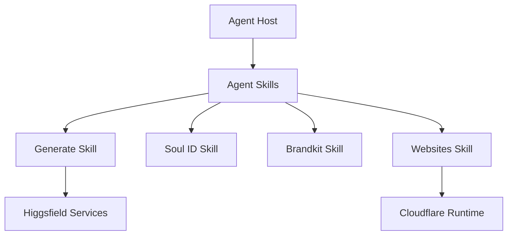

# higgsfield-ai/skills

> Skills for coding agents that drive image, video, brand and website generation via Higgsfield.

## The problem
Connecting an agent to a media generation service means writing the calls and the sequencing of steps by hand.

## What it actually does
A collection of Markdown skills: multi-model generation, Soul identity training, product photos, brandkit, marketplace cards, YouTube thumbnails, explainer videos, websites. Skills chain together (Soul then generate). The local Python code covers brandbook export and GLB processing. Most of the work goes through the Higgsfield services.

## How it is wired


## Trying it
```bash
npx skills add higgsfield-ai/skills
gh skill install higgsfield-ai/skills
git clone --depth 1 https://github.com/higgsfield-ai/skills.git
cd skills
./setup
```

## Cost and gotchas
A Higgsfield account and CLI authentication are required; generations are billed by the service (pricing not documented here). Website deployment goes through Cloudflare.

## What it is not
Not a local generation engine: these are instructions for an agent, backed by a SaaS. API details are not documented in the README.

## Alternatives
No alternative named in the README.

## For you
Worth watching: useful if your agent has to produce visuals, but you depend on a paid, closed service, loosely related to MLOps.
