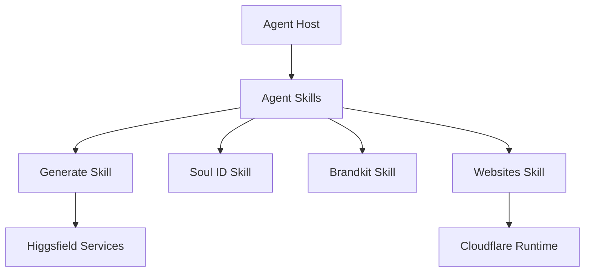

# higgsfield-ai/skills

> Skills pour agents de code qui pilotent la génération d'images, vidéos, marques et sites via Higgsfield.

## Le problème
Brancher un agent à un service de génération média demande d'écrire à la main les appels et l'enchaînement des étapes.

## Ce que ça fait vraiment
Collection de skills Markdown : génération multi-modèles, entraînement d'identité Soul, photos produit, brandkit, cartes marketplace, miniatures YouTube, vidéos explicatives, sites web. Les skills s'enchaînent (Soul puis generate). Le code Python local couvre l'export de brandbook et le traitement GLB. Le gros du travail passe par les services Higgsfield.

## Comment c'est branché


## Essayer
```bash
npx skills add higgsfield-ai/skills
gh skill install higgsfield-ai/skills
git clone --depth 1 https://github.com/higgsfield-ai/skills.git
cd skills
./setup
```

## Coût et pièges
Compte Higgsfield et authentification de la CLI requis ; les générations sont facturées par le service (tarif non documenté ici). Le déploiement de sites passe par Cloudflare.

## Ce que ce n'est pas
Pas un moteur de génération local : ce sont des instructions pour un agent, adossées à un SaaS. Détails d'API non documentés dans le README.

## Alternatives
Aucune alternative nommée dans le README.

## Pour toi
À surveiller : utile si ton agent doit produire des visuels, mais tu dépends d'un service payant et fermé, peu lié à du MLOps.

