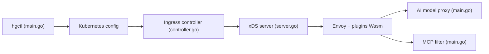

# higress-group/higress

> Cloud-native API gateway based on Istio/Envoy, with AI gateway features and MCP server hosting.

## The problem
Exposing several LLM providers, MCP tools and microservices requires a single gateway with auth, quotas and observability, without downtime on configuration reloads.

## What it actually does
A controller (Ingress, Gateway API, ConfigMap, Wasm plugins) that translates Kubernetes configuration into Envoy config via xDS. AI plugins: model proxy, multi-model load balancing, token limiting, cache, search, agent. MCP hosting with OpenAPI-to-MCP conversion. Wasm plugins in Go/Rust/JS, web console, deployment outside Kubernetes possible via Docker.

## How it is wired


## Trying it
```bash
mkdir higress; cd higress
docker run -d --rm --name higress-ai -v ${PWD}:/data \
        -p 8001:8001 -p 8080:8080 -p 8443:8443  \
        higress-registry.cn-hangzhou.cr.aliyuncs.com/higress/all-in-one:latest
```

## Cost and gotchas
Free software; images pulled from an Aliyun registry (US and Southeast Asia mirrors indicated). Running Kubernetes/Envoy is non-trivial; 1,124 open issues.

## What it is not
Not an LLM platform: it is a gateway in front of existing providers. Provider keys remain your responsibility. The figure "over 90% of needs covered" is a README claim, unverified.

## Alternatives
No alternative named in the README, apart from ingress-nginx, with which it claims compatibility and which it says is less resource-hungry.

## For you
Watch: of interest if you pool several LLMs and MCP servers on Kubernetes, too heavy for a simple local proxy.
