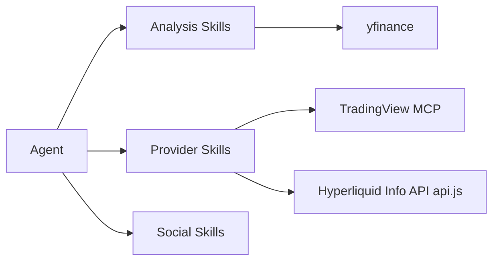

# himself65/finance-skills

> Collection of agent skills for financial analysis: valuation, earnings, sentiment, social network readers.

## The problem
A general-purpose agent cannot carry out structured financial analysis (DCF, balance sheets, options) without dedicated instructions.

## What it actually does
Installable plugin groups: market analysis via yfinance (valuation, earnings previews and reports, correlation, liquidity, options payoff), read-only readers (Discord, LinkedIn, Telegram, Twitter/X, Y Combinator), data providers (Adanos, Fintel, TradingView, Hyperliquid), startup analysis, generative UI design and a skill creator. TradingView and Hyperliquid readers are provided in JavaScript.

## How it is wired


## Trying it
```bash
npx plugins add himself65/finance-skills
npx plugins add himself65/finance-skills --yes
npx skills add himself65/finance-skills --skill yfinance-data
```

## Cost and gotchas
The skills depend on third-party services (Fintel, Adanos, opencli…), some requiring a key or account. Many go through yfinance, whose data reliability is not guaranteed.

## What it is not
Not financial advice (README disclaimer). The instructions of each skill were not reviewed in this summary.

## Alternatives
No alternative named in the README.

## For you
Worth watching: handy for giving an agent financial analysis reflexes; useful only if you do market finance.
