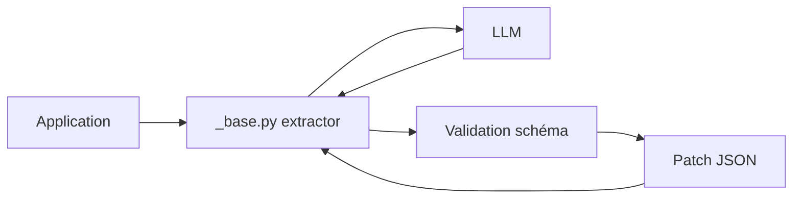

# hinthornw/trustcall

> Reliable JSON extraction by LLM: the model produces JSON patches rather than the whole document.

## The problem
An LLM often fails to fill large nested schemas and erases fields when asked to update an object.

## What it actually does
`create_extractor(llm, tools=[...])` asks for the tool arguments, validates them (Pydantic, schema dictionaries or Python functions) and, on error, asks again for a targeted JSON patch. With an `existing` dictionary, it only generates patches on existing objects; `enable_inserts=True` handles updates and creations. Works with LangChain's tool-calling LLMs.

## How it is wired


## Trying it
```bash
pip install trustcall
pip install -U trustcall langchain-fireworks
make evals
```
```python
from trustcall import create_extractor
bound = create_extractor(llm, tools=[User])
```

## Cost and gotchas
Every call consumes the LLM; the examples use gpt-4o (OpenAI) or Fireworks, so an API key at your expense. The evaluations require keys and cloning a LangSmith dataset. Last push in July 2025.

## What it is not
Not a guarantee against every error: it is a patch-based retry loop. The author writes that you can recreate the logic yourself in a few hours.

## Alternatives
The README only compares against naive LLM tool calling, with no competing repository named.

## For you
Watch: the "patch, don't regenerate" pattern is useful for agent memory, but simple to reproduce and not very active since July 2025.
