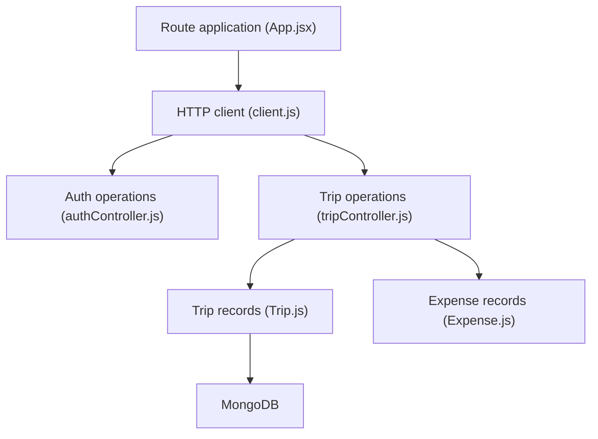

# hitesh-kumar123/Travel-Plans-

> MERN travel-planning application: trips, expenses, weather, translation, aimed at web developers.

## The problem
Itineraries, budgets and travel tools are scattered across several applications.

## What it actually does
Trip management, expense tracking with Recharts charts and CSV export, OpenWeatherMap weather (5 days), translation via `google-translate-api-x` without a key, JWT authentication. Flight and hotel search and booking use **mock data**. The README calls itself "production-ready"; this is not demonstrated.

## How it is wired


## Trying it
```bash
git clone https://github.com/hitesh-kumar123/Travel-Plans-.git
cd Travel-Plans-
cp .env.example server/.env
cd server && npm install && npm run dev
# autre terminal :
cd client && npm install && npm start
```

## Cost and gotchas
MongoDB (local or Atlas) and a free OpenWeatherMap key are required; `JWT_SECRET` must be set. Running from the root fails. 509 open issues.

## What it is not
Not a real booking tool. Messy README (broken code blocks).

## Alternatives
No alternative named in the README.

## For you
Ignore: general-purpose web application with no data/AI component (the AI itinerary is only a roadmap idea).
