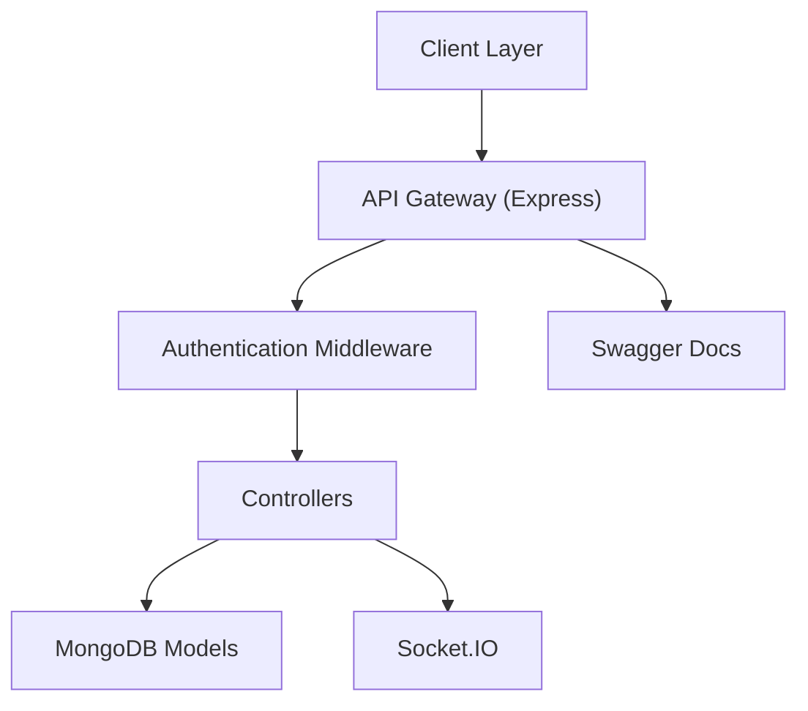

# hiteshchoudhary/apihub

> Hub of free APIs (FreeAPI.app) to learn how to consume APIs and fill a front-end portfolio.

## The problem
Beginners lack realistic, free APIs to practice front-end integration without building one themselves.

## What it actually does
Express server on MongoDB exposing learning APIs: JWT authentication, chat (Socket.IO), e-commerce, todo, social network, plus public APIs. Swagger documentation generated from `swagger.yaml`. Playwright tests cover the endpoints. The public server is reset (files and database) every two hours to limit costs.

## How it is wired


## Trying it
```bash
docker-compose up --build --attach backend
yarn install
yarn start
yarn start:test-server
yarn test:playwright
```

## Cost and gotchas
Free, but you must create a `.env` from `.env.sample` with credentials. On the public instance, all data disappears every two hours: self-host for any lasting use.

## What it is not
Not a production API nor a data catalog: it is a practice ground with data that gets reset.

## Alternatives
No alternative named in the README.

## For you
Ignore for data/AI work: it is a web teaching tool, unrelated to models or data; the license also needs checking.
