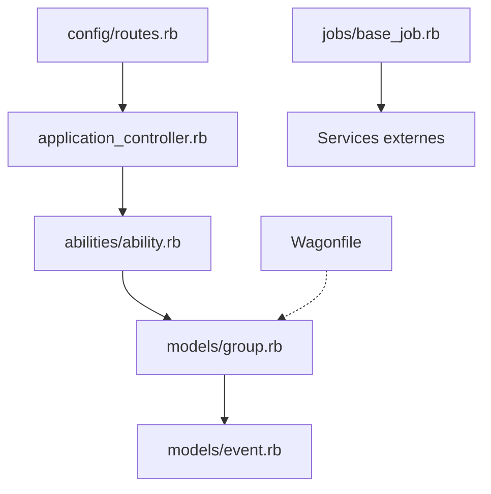

# hitobito/hitobito

> Free Rails web application for managing organizations with complex group hierarchies: members, events, mailings.

## The problem
Associations and federations have tree structures, roles and permissions that a generic tool handles poorly.

## What it actually does
A meta-model of typed groups in a tree, with roles and permissions. The core defines no group type: you need at least one "wagon" (plugin) such as `hitobito_generic`. Events, invoicing, EBICS payments, mailings, exports, JSON:API API and OAuth/OIDC.

## How it is wired


## Trying it
```bash
# Aucune commande dans le README : voir doc/developer et les instructions de déploiement.
```

## Cost and gotchas
Free (AGPL), self-hosted: Rails (Ruby not listed in the prerequisites), MySQL, Delayed Job; a Dockerfile and OpenShift manifests are provided. User guide in German. 402 open issues.

## What it is not
Not a ready-to-use tool: without a wagon, it has no group structure at all.

## Alternatives
No alternative named in the README.

## For you
Ignore: association management software, unrelated to your data/AI/MLOps work.
