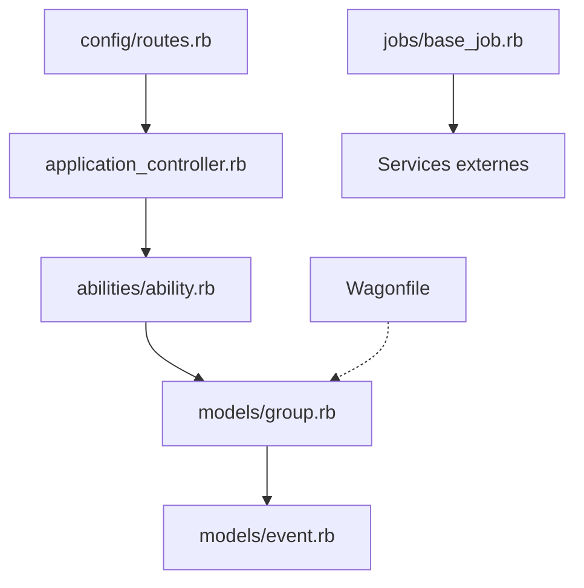

# hitobito/hitobito

> Application web Rails libre pour gérer des organisations aux hiérarchies de groupes complexes : membres, événements, courriers.

## Le problème
Les associations et fédérations ont des structures en arbre, des rôles et des droits qu'un outil générique gère mal.

## Ce que ça fait vraiment
Un méta-modèle de groupes typés en arbre, avec des rôles et des permissions. Le cœur ne définit aucun type de groupe : il faut au moins un « wagon » (plugin) comme `hitobito_generic`. Événements, facturation, paiements EBICS, envois de courrier, exports, API JSON:API et OAuth/OIDC.

## Comment c'est branché


## Essayer
```bash
# Aucune commande dans le README : voir doc/developer et les instructions de déploiement.
```

## Coût et pièges
Gratuit (AGPL), à héberger : Rails (Ruby non listé dans les prérequis), MySQL, Delayed Job ; un Dockerfile et des manifestes OpenShift sont fournis. Guide utilisateur en allemand. 402 issues ouvertes.

## Ce que ce n'est pas
Pas un outil prêt à l'emploi : sans wagon, il n'a aucune structure de groupes.

## Alternatives
Aucune alternative nommée dans le README.

## Pour toi
À ignorer : logiciel de gestion d'associations, à part de ton travail data/IA/MLOps.

