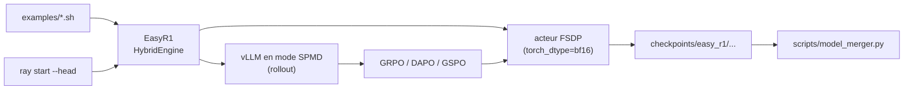

# hiyouga/EasyR1

> Fork of veRL for reinforcement-learning training of language and vision-language models.

## The problem
veRL did not cover vision-language models; adding multimodality to an existing GRPO pipeline
means touching the training engine and the rollout engine at the same time.

## What it actually does
Takes veRL and adds Qwen2-VL / Qwen2.5-VL / Qwen3-VL, on top of the text models Llama3, Qwen2/3
and the DeepSeek-R1 distillations. Implements GRPO, DAPO, Reinforce++, ReMax, RLOO, GSPO, CISPO.
Accepts any text or vision-text dataset in the expected format, with padding-free training, LoRA,
resuming from the latest or best checkpoint, and tracking with Wandb / SwanLab / MLflow / TensorBoard.
The README quantifies the required VRAM from 1.5B to 72B, in AMP and BF16, full-parameter and LoRA.

## How it is wired


## Trying it
```bash
docker pull hiyouga/verl:ngc-th2.8.0-cu12.9-vllm0.11.0
docker run -it --ipc=host --gpus=all hiyouga/verl:ngc-th2.8.0-cu12.9-vllm0.11.0
git clone https://github.com/hiyouga/EasyR1.git && cd EasyR1 && pip install -e .
bash examples/qwen2_5_vl_7b_geo3k_grpo.sh
bash examples/qwen3_vl_4b_geo3k_grpo_lora.sh
python3 scripts/model_merger.py --local_dir checkpoints/easy_r1/exp_name/global_step_1/actor
ray start --head --port=6379 --dashboard-host=0.0.0.0
```

## Cost and gotchas
Free, but the entry ticket is hardware: 2×24 GB for a 1.5B in AMP, 32×80 GB for a 72B.
Tight dependencies (`vllm>=0.8.3`, `flash-attn`, `transformers>=4.54.0`), hence the provided Docker image.
`deepspeed` installed in the same environment breaks execution and must be uninstalled.

## What it is not
Not an SFT or inference tool: the README explicitly rules it out and points to LlamaFactory. VLMs
are not yet compatible with Ulysses parallelism — a known and acknowledged bug. The README
also hosts promotion for another project by the same author.

## Alternatives
- veRL: the original project, without vision-language support.
- LlamaFactory: for SFT and inference, which this repository refuses to cover.

## For you
The shortest path to a reproducible multimodal GRPO, if you have the GPUs in front of you.
