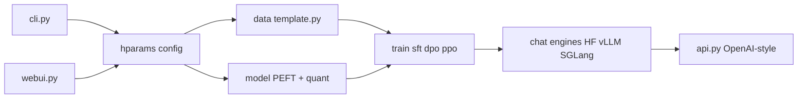

# hiyouga/LlamaFactory

> A toolkit for fine-tuning LLMs and VLMs using a command-line interface, web UI, or API, without requiring any coding.

## The problem
Fine-tuning an open model requires assembling Transformers, PEFT, TRL, quantization, and chat templates, with different settings for each model family.

## What it actually does
`llamafactory-cli` (`cli.py`), the Gradio Web UI (`webui.py`), and the API (`api.py`) all use the same configuration (`hparams/`), which controls data, the model, training, and service.
Methods: pre-training, SFT, reward model, PPO, DPO, KTO, ORPO; full, freeze, LoRA, QLoRA 2 to 8 bits; GaLore, DoRA, LongLoRA, etc. Chat templates and tool calls are in `template.py`.
Inference is performed via Hugging Face, vLLM, or SGLang through an OpenAI-formatted API. Monitoring: LlamaBoard, TensorBoard, Wandb, MLflow. A more modular "v1" stack exists alongside the classic stack.

## How it is wired


## Trying it
```bash
pip install "huggingface_hub<1.0.0"
huggingface-cli login
```
The "usage" section is incomplete in the portion of the README that was read: no other command is listed.

## Cost and gotchas
Free, Apache-2.0 license; GPU required (CUDA, ROCm, or Ascend NPU); Python 3.11 or higher. Some datasets require a Hugging Face account.

## What it is not
Not a managed service: you provide the hardware. Both the classic and v1 versions are present, which makes it difficult to interpret the code. The README highlights the PenguinHarness project from the same team.

## Alternatives
No alternative is mentioned in the README (Unsloth is listed as an integrated acceleration feature).

## For you
Recommended for your LoRA/DPO fine-tuning on open models.
