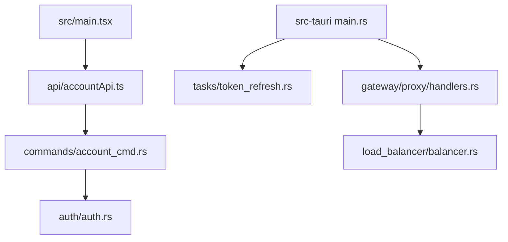

# hj01857655/kiro-account-manager

> Tauri application to manage multiple Kiro IDE accounts, with switching and an OpenAI/Anthropic-compatible API gateway.

## The problem
Juggling Kiro accounts and tracking quotas by hand, while wanting to plug Claude Code or Cursor into Kiro.

## What it actually does
Imports and refreshes accounts (Google, GitHub, AWS IAM, Entra ID), switches accounts in the IDE, resets the machine identifier, switches automatically when the quota drops, and synchronizes MCP, hooks, skills. A local gateway (port 8765) converts Anthropic and OpenAI requests to Kiro with load balancing across accounts.

## How it is wired


## Trying it
```bash
git clone https://github.com/hj01857655/kiro-account-manager.git
cd kiro-account-manager
bun install
bun run tauri dev
```

## Cost and gotchas
License announced as CC BY-NC-SA 4.0 (commercial use prohibited) but not identified by GitHub. The README states the application is unsigned on macOS. An account pool and changing the machine identifier may violate Kiro's terms of service.

## What it is not
Not an official Kiro tool. The gateway key is fixed to "kiro", so do not expose it beyond the local machine.

## Alternatives
No alternative named in the README.

## For you
Ignore: quota-circumvention tool carried by a single person, under a non-commercial license and with a risk of account blocking.
