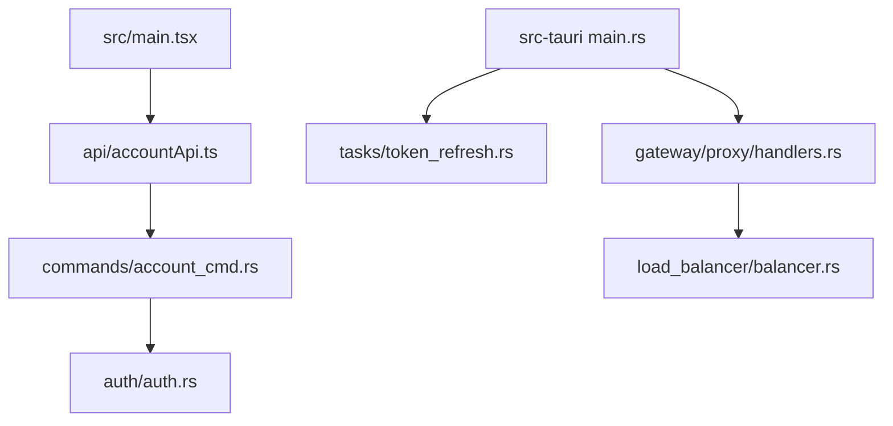

# hj01857655/kiro-account-manager

> Application Tauri pour gérer plusieurs comptes Kiro IDE, avec bascule et passerelle API compatible OpenAI/Anthropic.

## Le problème
Jongler entre comptes Kiro et suivre les quotas à la main, tout en voulant brancher Claude Code ou Cursor sur Kiro.

## Ce que ça fait vraiment
Importe et rafraîchit des comptes (Google, GitHub, AWS IAM, Entra ID), change de compte dans l'IDE, réinitialise l'identifiant machine, bascule automatiquement quand le quota baisse, et synchronise MCP, hooks, skills. Une passerelle locale (port 8765) convertit des requêtes Anthropic et OpenAI vers Kiro avec répartition de charge entre comptes.

## Comment c'est branché


## Essayer
```bash
git clone https://github.com/hj01857655/kiro-account-manager.git
cd kiro-account-manager
bun install
bun run tauri dev
```

## Coût et pièges
Licence annoncée CC BY-NC-SA 4.0 (usage commercial interdit) mais non identifiée par GitHub. Le README indique une application non signée sur macOS. Un pool de comptes et le changement d'identifiant machine peuvent contrevenir aux conditions du service Kiro.

## Ce que ce n'est pas
Pas un outil officiel de Kiro. La clé de la passerelle est fixée à « kiro », donc à ne pas exposer hors machine locale.

## Alternatives
Aucune alternative nommée dans le README.

## Pour toi
Ignorer : outil de contournement de quotas porté par une seule personne, sous licence non commerciale et risque de blocage des comptes.

