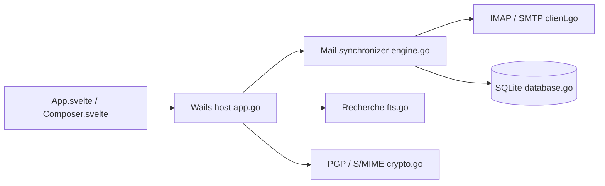

# hkdb/aerion

> Lightweight desktop mail client (Wails + Svelte) for Linux, inspired by Geary, with no dependency on GNOME accounts.

## The problem
On Linux, mail clients are considered heavy or dependent on system services (Thunderbird, Geary, Evolution, Mailspring on Electron).

## What it actually does
Handles several accounts (IMAP/SMTP, Gmail, Microsoft 365, Yahoo, Proton via Bridge, etc.), a unified inbox, conversation threads, a WYSIWYG composer, local and IMAP search, PGP and S/MIME, notifications. A calendar and contacts extension (alpha) is disabled by default. The Go/Wails host syncs and stores in SQLite.

## How it is wired

## Trying it
The README gives no command: it points to the official installation guide and the documentation.

## Cost and gotchas
Free; some providers are marked "not yet tested". The README admits the project relies heavily on Claude models for implementation. 118 open issues.

## What it is not
It is not a mature client: repository created in January 2026, calendar and contacts in alpha. There is no webmail and no server.

## Alternatives
- Thunderbird, Geary, Mailspring, Evolution: cited as the clients it aims to replace.

## For you
Worth watching: a lightweight mail client to follow if you are on Linux, but unrelated to data or MLOps, and very young.
