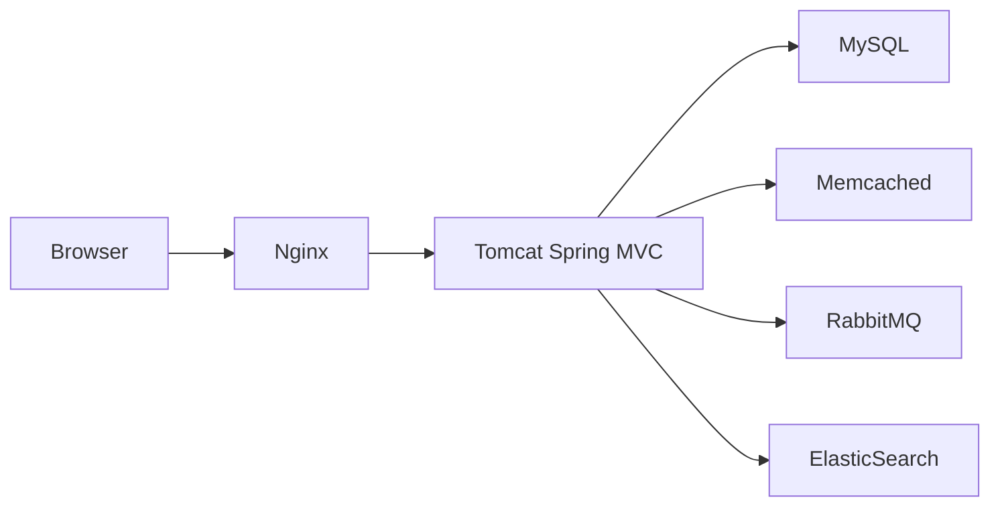

# hkhcoder/vprofile-project

> Demo Java Spring MVC application for DevOps exercises (CI/CD, Ansible, Vagrant).

## The problem
DevOps courses need a realistic multi-service application to deploy.

## What it actually does
Spring MVC monolith packaged as a WAR under Tomcat: account management, file upload, ElasticSearch search, RabbitMQ messaging, Memcached cache, MySQL database. Provides Ansible playbooks, Vagrantfiles and a Jenkinsfile. The README only lists prerequisites (JDK 17 or 21, Maven 3.9, MySQL 8), technologies and the SQL dump import.

## How it is wired


## Trying it
```bash
mysql -u <user> -p accounts < db_backup.sql
```

## Cost and gotchas
Free, but you have to set up MySQL, Memcached, RabbitMQ and ElasticSearch. No license declared.

## What it is not
Not a production application: it is an exercise support. The README does not describe how to run it.

## Alternatives
No alternative named in the README.

## For you
Ignore: a generic DevOps training example, with no license and a README too thin to be usable.
