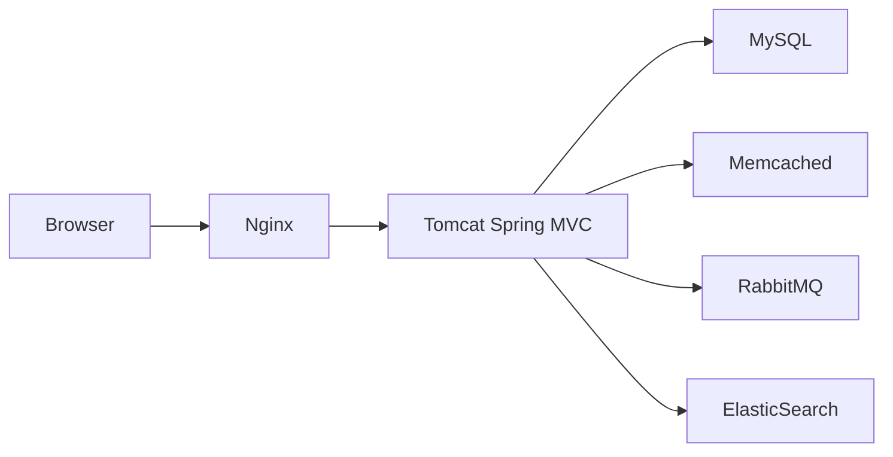

# hkhcoder/vprofile-project

> Application Java Spring MVC de démonstration pour exercices DevOps (CI/CD, Ansible, Vagrant).

## Le problème
Les formations DevOps ont besoin d'une application multi-services réaliste à déployer.

## Ce que ça fait vraiment
Monolithe Spring MVC en WAR sous Tomcat : gestion de comptes, envoi de fichiers, recherche ElasticSearch, messagerie RabbitMQ, cache Memcached, base MySQL. Fournit des playbooks Ansible, des Vagrantfiles et un Jenkinsfile. Le README ne liste que prérequis (JDK 17 ou 21, Maven 3.9, MySQL 8), technologies et import du dump SQL.

## Comment c'est branché


## Essayer
```bash
mysql -u <user> -p accounts < db_backup.sql
```

## Coût et pièges
Gratuit, mais il faut monter MySQL, Memcached, RabbitMQ et ElasticSearch. Aucune licence déclarée.

## Ce que ce n'est pas
Pas une application de production : c'est un support d'exercice. Le README ne décrit pas comment la lancer.

## Alternatives
Aucune alternative nommée dans le README.

## Pour toi
À ignorer : exemple d'entraînement DevOps générique, sans licence, avec un README trop mince pour être exploitable.

