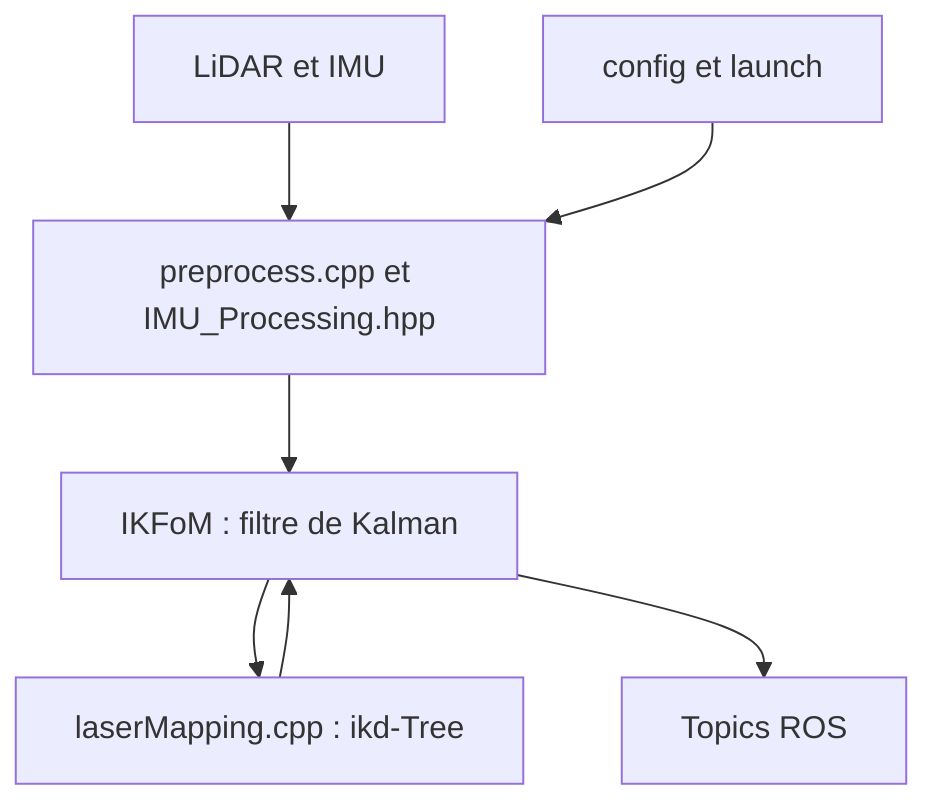

# hku-mars/FAST_LIO

> Fast LiDAR-inertial odometry for robots, fusing point clouds and IMU with an iterated Kalman filter.

## The problem
Estimating the position of a fast-moving robot, or one in a degraded environment, from a LiDAR and an inertial unit.

## What it actually does
A ROS package that fuses LiDAR points and IMU data in an iterated extended Kalman filter, then builds an incremental map with ikd-Tree. FAST-LIO 2 processes raw points, without feature extraction, and supports Livox, Velodyne and Ouster LiDARs, as well as ARM platforms. It can save scans to a PCD file.

## How it is wired


## Trying it
```bash
git clone https://github.com/hku-mars/FAST_LIO.git
cd FAST_LIO
git submodule update --init
cd ../..
catkin_make
source devel/setup.bash
roslaunch fast_lio mapping_velodyne.launch
```

## Cost and gotchas
Free. Requires Ubuntu, ROS Melodic or later, PCL, Eigen and, for Livox, livox_ros_driver. The LiDAR and IMU must be synchronized. A Docker container in privileged mode is documented. GPL-2.0 license.

## What it is not
Not a full SLAM tool: no loop closure or relocalization (separate extensions). It cannot be installed with pip.

## Alternatives
FAST-LIO-LOCALIZATION, FAST-LIVO and R2LIVE are cited as extensions from the same group; the README presents no competitor.

## For you
Ignore unless you do mobile robotics: ROS and LiDAR stack unrelated to classic MLOps.
