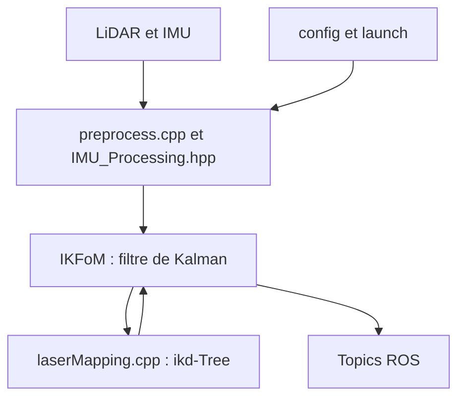

# hku-mars/FAST_LIO

> Odométrie LiDAR-inertielle rapide pour robots, fusionnant nuage de points et IMU par filtre de Kalman itéré.

## Le problème
Estimer la position d'un robot en mouvement rapide ou en environnement dégradé à partir d'un LiDAR et d'une centrale inertielle.

## Ce que ça fait vraiment
Paquet ROS qui fusionne les points LiDAR et les données IMU dans un filtre de Kalman étendu itéré, puis construit une carte incrémentale avec ikd-Tree. FAST-LIO 2 traite les points bruts, sans extraction de caractéristiques, et prend en charge des LiDAR Livox, Velodyne et Ouster, ainsi que des plateformes ARM. Il peut enregistrer les scans en fichier PCD.

## Comment c'est branché


## Essayer
```bash
git clone https://github.com/hku-mars/FAST_LIO.git
cd FAST_LIO
git submodule update --init
cd ../..
catkin_make
source devel/setup.bash
roslaunch fast_lio mapping_velodyne.launch
```

## Coût et pièges
Gratuit. Il faut Ubuntu, ROS Melodic ou plus, PCL, Eigen et, pour Livox, livox_ros_driver. Le LiDAR et l'IMU doivent être synchronisés. Un conteneur Docker en mode privilégié est documenté. Licence GPL-2.0.

## Ce que ce n'est pas
Ce n'est pas un outil de SLAM complet : pas de fermeture de boucle ni de relocalisation (extensions séparées). Il ne s'installe pas avec pip.

## Alternatives
FAST-LIO-LOCALIZATION, FAST-LIVO et R2LIVE sont cités comme extensions du même groupe ; le README ne présente pas de concurrent.

## Pour toi
À ignorer sauf si tu fais de la robotique mobile : pile ROS et LiDAR sans rapport avec le MLOps classique.

