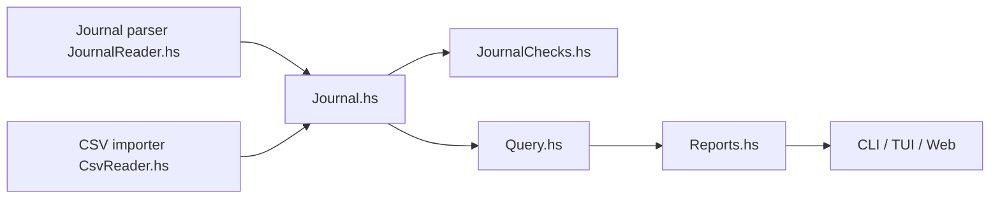

# hledger

> Plain-text, multi-currency double-entry accounting, for individuals and freelancers comfortable with the CLI.

## The problem
Tracking money, time and invoices in a durable, version-controllable, cloud-free format.

## What it actually does
Reads a plain-text journal file (or CSV with import rules), checks that it balances and produces balance sheets, income statements, registers and budgets. Interfaces: command line, terminal (hledger-ui), web. Outputs text/HTML/JSON/SQL/CSV. Partly compatible with Ledger, interconvertible with Beancount. 1.x branch kept, 2.x under development on `main`.

## How it is wired


## Trying it
```bash
hledger bs
hledger is --monthly
```

## Cost and gotchas
Free; installation on unix, mac, Windows (details on the website). You have to enter or import the journal yourself.

## What it is not
Not a budgeting app with bank synchronization: the interfaces are "basic". GPL-3.0 license (copyleft).

## Alternatives
Ledger CLI and Beancount are cited as close/interconvertible.

## For you
Adopt for your finances or scripted time tracking: version-controllable text format and usable JSON/SQL export.
