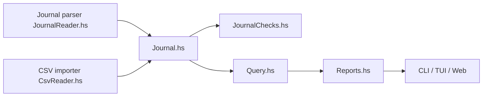

# hledger

> Comptabilité en partie double en texte brut, multidevise, pour particuliers et indépendants à l'aise en CLI.

## Le problème
Suivre argent, temps et factures dans un format durable, versionnable et sans cloud.

## Ce que ça fait vraiment
Lit un fichier journal texte (ou du CSV avec règles d'import), vérifie l'équilibrage et produit bilans, comptes de résultat, registres, budgets. Interfaces : ligne de commande, terminal (hledger-ui), web. Sorties texte/HTML/JSON/SQL/CSV. Compatible en partie avec Ledger, interconvertible avec Beancount. Branche 1.x conservée, 2.x en développement sur `main`.

## Comment c'est branché


## Essayer
```bash
hledger bs
hledger is --monthly
```

## Coût et pièges
Gratuit ; installation sur unix, mac, Windows (détails sur le site). Le journal est à saisir ou importer vous-même.

## Ce que ce n'est pas
Pas une appli de budget avec synchronisation bancaire : les interfaces sont « basiques ». Licence GPL-3.0 (copyleft).

## Alternatives
Ledger CLI et Beancount sont cités comme proches/interconvertibles.

## Pour toi
À adopter pour tes finances ou un suivi de temps scripté : format texte versionnable et export JSON/SQL exploitable.

