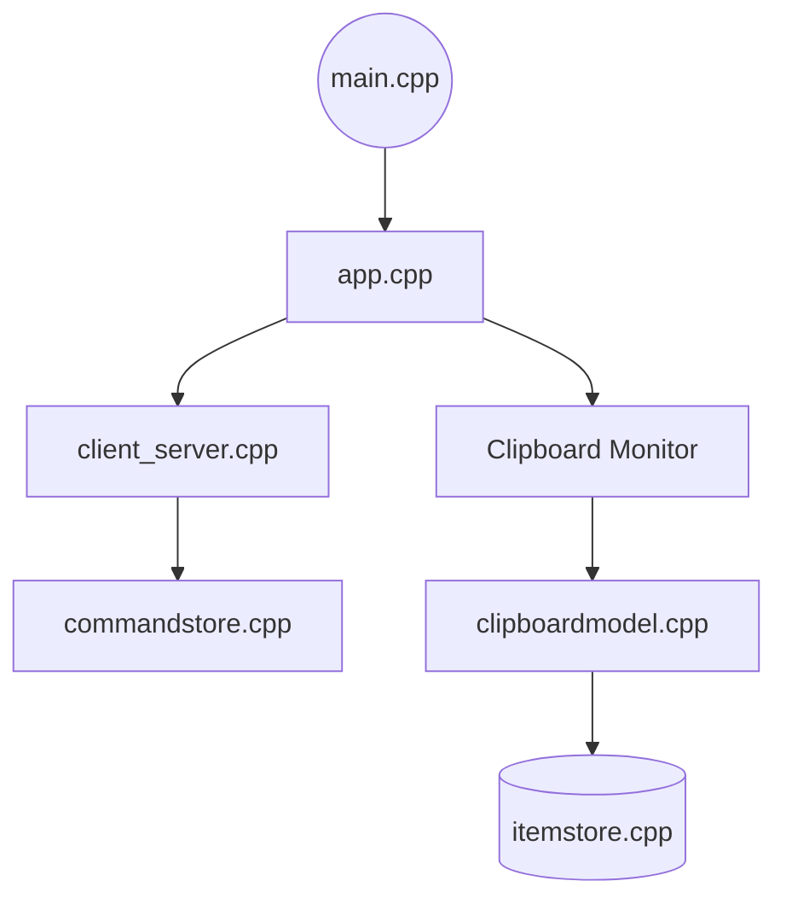

# hluk/CopyQ

> Clipboard history manager with tabs, scripting and a command line, for Linux, Windows and macOS.

## The problem
The system clipboard only keeps one item, the last one copied.

## What it actually does
It watches the clipboard and saves text, HTML, images and custom formats into tabs. You can search, edit, sort and paste; commands trigger on a shortcut or when the content changes. A CLI and a scripting API drive the running instance. C++/Qt 6, with X11, Wayland, Windows and macOS adapters.

## How it is wired


## Trying it
```bash
brew install --cask copyq
scoop install copyq
copyq toggle
copyq add -- 'first item' 'second item'
copyq read 0 1 2
```

## Cost and gotchas
Free. The CLI requires the application to be running. On macOS, the app may be flagged as "damaged": two commands, `xattr` and `codesign`, unblock it.

## What it is not
Not an AI productivity tool nor a cloud-synced service. GPL-3.0 license: copyleft.

## Alternatives
No alternative cited in the README.

## For you
Ignore for data / AI monitoring: a solid desktop utility, but unrelated to your line of work.
