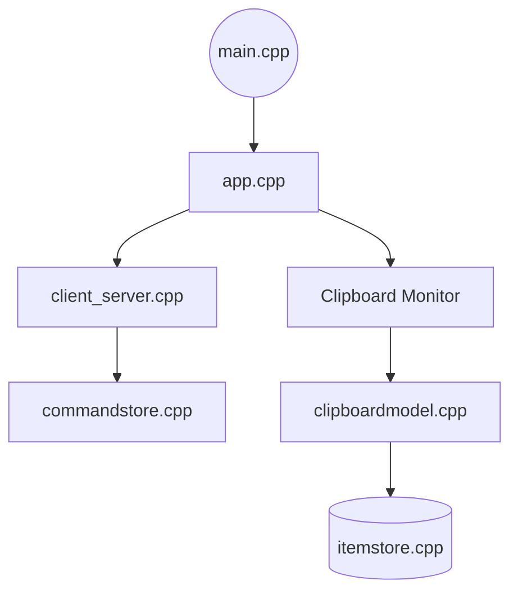

# hluk/CopyQ

> Gestionnaire d'historique du presse-papiers avec onglets, scripts et ligne de commande, pour Linux, Windows et macOS.

## Le problème
Le presse-papiers système ne garde qu'un élément, le dernier copié.

## Ce que ça fait vraiment
Il surveille le presse-papiers et enregistre texte, HTML, images et formats personnalisés dans des onglets. On y recherche, édite, trie, colle ; des commandes se déclenchent par raccourci ou au changement de contenu. Un CLI et une API de script pilotent l'instance en cours. C++/Qt 6, adaptateurs X11, Wayland, Windows, macOS.

## Comment c'est branché


## Essayer
```bash
brew install --cask copyq
scoop install copyq
copyq toggle
copyq add -- 'first item' 'second item'
copyq read 0 1 2
```

## Coût et pièges
Gratuit. Le CLI exige que l'application tourne. Sur macOS, l'app peut être signalée « endommagée » : deux commandes `xattr` et `codesign` la débloquent.

## Ce que ce n'est pas
Pas un outil de productivité IA ni un service synchronisé dans le cloud. Licence GPL-3.0 : copyleft.

## Alternatives
Aucune alternative citée dans le README.

## Pour toi
À ignorer pour la veille data / IA : utilitaire de bureau solide, mais sans lien avec ton métier.

