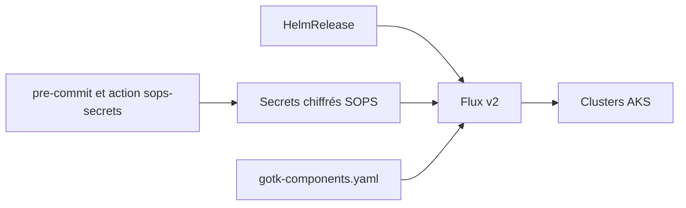

# hmcts/cnp-flux-config

> Flux v2 configuration of a team's AKS clusters, for the platform engineers of that organization.

## The problem
Deploying applications to several AKS clusters by hand leads to drift. A single, versioned source is needed that describes what runs where.

## What it actually does
The repo contains the `HelmRelease` manifests of each application, managed by Flux v2. Secrets are encrypted there with SOPS, with a pre-commit hook and a GitHub action that block plaintext secrets. Flux's `gotk-components.yaml` files are maintained by Renovate.

## How it is wired
Simplified diagram based on the fiche, no diagram provided.



## Trying it
```bash
brew install pre-commit
pre-commit install
yq eval -I 2 --inplace apps/mi/mi-adf-shir/sbox/mi-adf-auth-values.enc.yaml
flux install --export > apps/flux-system/base/gotk-components.yaml
```

## Cost and gotchas
Assumes AKS clusters, SOPS keys and access to the organization. Outside that context, the repo cannot be run as is.

## What it is not
Not a reusable tool: it is one team's own configuration. The README refers to other documents for the repo's organization.

## Alternatives
No alternative named in the README.

## For you
To ignore as a tool: useful only as an example of Flux and SOPS GitOps to read, not to install.
