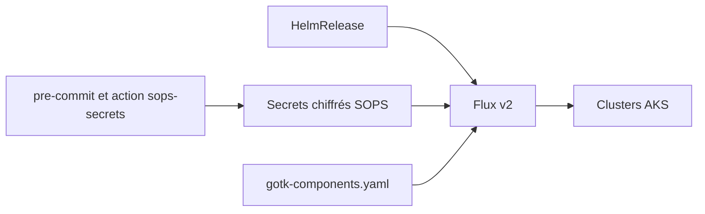

# hmcts/cnp-flux-config

> Configuration Flux v2 des clusters AKS d'une équipe, pour les ingénieurs plateforme de cette organisation.

## Le problème
Déployer des applications sur plusieurs clusters AKS à la main est source de dérives. Il faut une source unique, versionnée, qui décrit ce qui tourne où.

## Ce que ça fait vraiment
Le dépôt contient les manifestes `HelmRelease` de chaque application, gérés par Flux v2. Les secrets y sont chiffrés avec SOPS, avec un hook pre-commit et une action GitHub qui bloquent les secrets en clair. Les fichiers `gotk-components.yaml` de Flux sont maintenus par Renovate.

## Comment c'est branché
Schéma simplifié d'après la fiche, sans diagramme fourni.



## Essayer
```bash
brew install pre-commit
pre-commit install
yq eval -I 2 --inplace apps/mi/mi-adf-shir/sbox/mi-adf-auth-values.enc.yaml
flux install --export > apps/flux-system/base/gotk-components.yaml
```

## Coût et pièges
Suppose des clusters AKS, des clés SOPS et un accès à l'organisation. Hors de ce contexte, le dépôt n'est pas exécutable tel quel.

## Ce que ce n'est pas
Pas un outil réutilisable : c'est la configuration propre à une équipe. Le README renvoie à d'autres documents pour l'organisation du dépôt.

## Alternatives
Aucune alternative nommée dans le README.

## Pour toi
À ignorer comme outil : utile seulement comme exemple de GitOps Flux et SOPS à lire, pas à installer.

