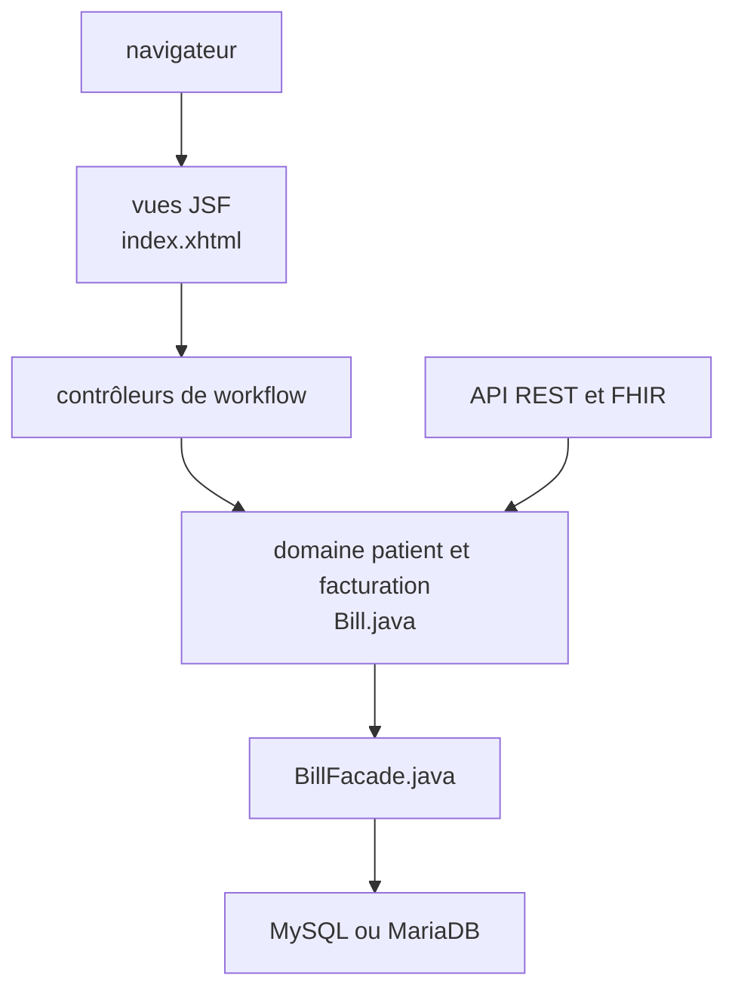

# hmislk/hmis

> Java hospital information system (patient record, pharmacy, laboratory, billing) for clinics and hospitals.

## The problem
A hospital must link patient records, billing, pharmacy, laboratory and stock, often in separate tools.

## What it actually does
Java EE web application (Maven, JSF) with a MySQL or MariaDB database. Modules: medical record, consultations, inpatient care, pharmacy, laboratory, HR, stock. Exposes REST (JAX-RS) and FHIR, SAP synchronization, an Anthropic AI chat and versioned SQL migrations, judging by the code.

## How it is wired

## Trying it
Commands not documented: the README describes only three steps (clone, set up an empty database, run).

## Cost and gotchas
You must provide a Java EE application server and MySQL or MariaDB. 2,523 open issues. The README states an MIT license, the catalogue says GPL-3.0: check before reuse.

## What it is not
Not a one-click install tool. Health data: compliance is your responsibility.

## Alternatives
Not documented in the README.

## For you
Ignore: specialized hospital software, outside the data, AI or MLOps scope.
