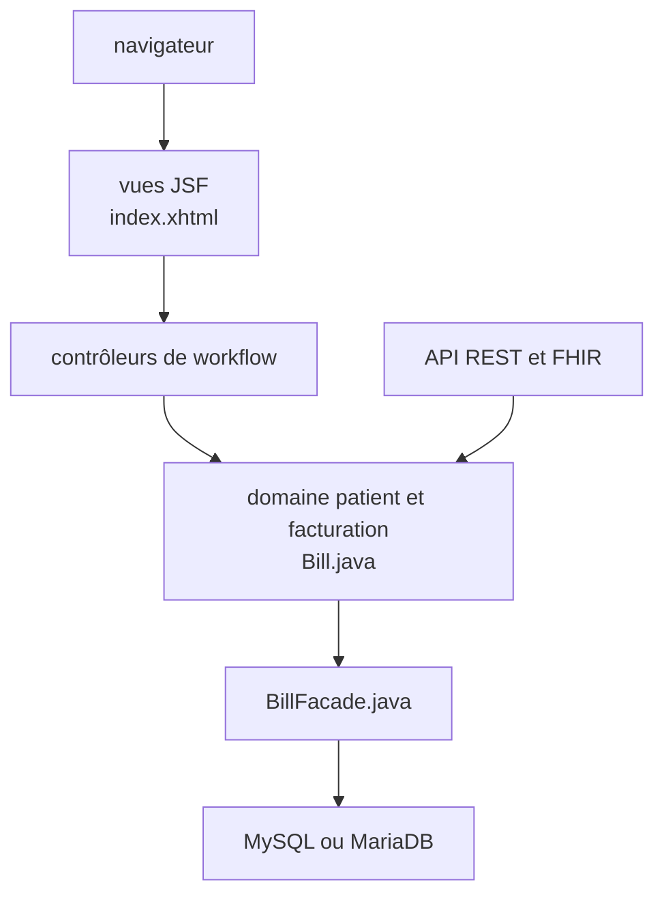

# hmislk/hmis

> Système d'information hospitalier Java (dossier patient, pharmacie, laboratoire, facturation) pour cliniques et hôpitaux.

## Le problème
Un hôpital doit relier dossiers patients, facturation, pharmacie, laboratoire et stocks, souvent dans des outils séparés.

## Ce que ça fait vraiment
Application web Java EE (Maven, JSF) avec base MySQL ou MariaDB. Modules : dossier médical, consultations, hospitalisation, pharmacie, laboratoire, RH, stocks. Exposition REST (JAX-RS) et FHIR, synchronisation SAP, chat IA Anthropic et migrations SQL versionnées d'après le code.

## Comment c'est branché

## Essayer
Commandes non documentées : le README décrit seulement trois étapes (cloner, configurer une base vide, lancer).

## Coût et pièges
Serveur d'applications Java EE et MySQL ou MariaDB à fournir. 2 523 issues ouvertes. Le README annonce une licence MIT, le catalogue GPL-3.0 : à vérifier avant réutilisation.

## Ce que ce n'est pas
Pas un outil prêt à installer en un clic. Données de santé : conformité à ta charge.

## Alternatives
Non documenté dans le README.

## Pour toi
À ignorer : logiciel hospitalier métier, hors périmètre data, IA ou MLOps.

