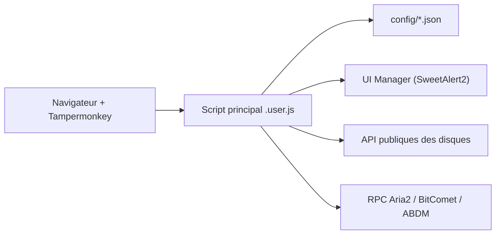

# hmjz100/LinkSwift

> User script that retrieves direct download links from nine Chinese storage services.

## The problem
The official clients of some online drives are constraining; you want a direct link to feed another download manager.

## What it actually does
A userscript (Tampermonkey or equivalent) that injects buttons into the pages of Baidu, Alibaba, China Mobile, Tianyi, Xunlei, Guangya, Quark, UC and 123 Pan. It calls their public APIs to obtain the links, restyles the pages and pushes the links to Aria2, BitComet, IDM or AB Download Manager. Each service has a JSON config file. The README, in Chinese, states that the project does not bypass any speed limit.

## How it is wired

## Trying it
No command: you install the script from a link (GitHub, OpenUserJS or ScriptCat), the canary version being the unstable one.

## Cost and gotchas
Free, but you need an account on each targeted drive and a script manager. One person maintains the script; bug reports are only accepted on GitHub. AGPL-3.0 license.

## What it is not
It is not a download accelerator, the author says so explicitly. Versions obtained outside the official channels come with no guarantee.

## Alternatives
The README cites the original script, `syhyz1990/baiduyun` ("Direct Link Download Assistant"), from which LinkSwift is derived.

## For you
Ignore: a convenience tool for Chinese services, maintained by a single person and outside the data / AI field.
