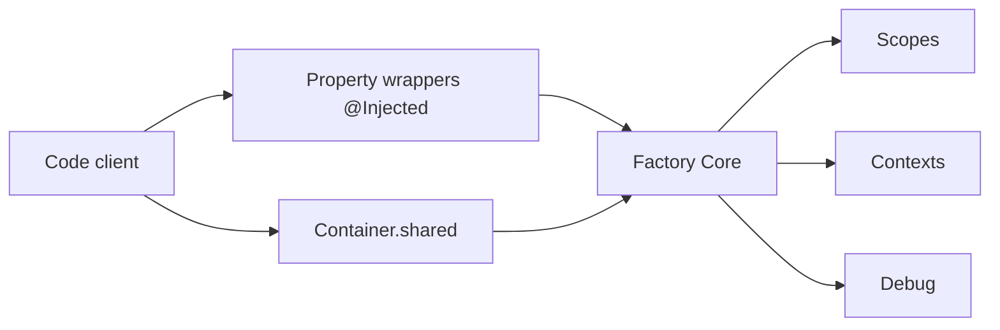

# hmlongco/Factory

> Container-based dependency injection library for Swift and SwiftUI, for iOS and macOS developers.

## The problem
Without dependency injection, views and models hard-code the creation of their services, which makes previews and tests hard to isolate.

## What it actually does
You declare a service as a computed property of a `Container` (`self { MyService() }`), then inject it with `@Injected` or by calling the container. Scopes (singleton, cached, shared, session) control lifetime. Contexts (debug, preview, tests, UITests) let you substitute stand-ins; a `.container` trait isolates Swift Testing tests. Resolution tracing is available in debug mode.

## How it is wired


## Trying it
```swift
extension Container {
    var myService: Factory<MyServiceType> {
        self { MyService() }
    }
}
```
Install via Swift Package Manager, then `import FactoryKit`.

## Cost and gotchas
Free. Do not copy `FactoryKit` into the test target (duplicate factories). Since 3.x, CocoaPods is no longer supported. Macros are unpublished.

## What it is not
It is not an architecture framework, only an injection container. It is maintained by a single person.

## Alternatives
Resolver (by the same author, cited in the README) if you are still on an earlier version.

## For you
Ignore: purely iOS/Swift, unrelated to data or MLOps.
