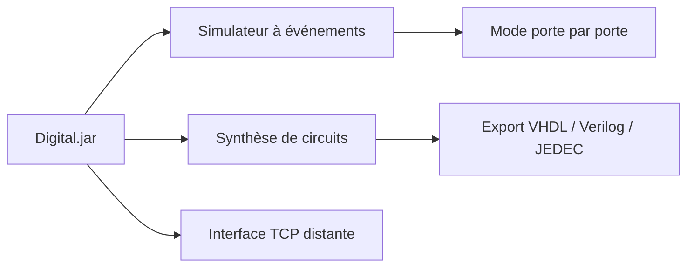

# hneemann/Digital

> A digital logic simulator for teaching, with export to VHDL, Verilog and FPGA.

## The problem
Learning logic circuit design requires a clear tool that shows oscillations and tests the designs.

## What it actually does
It simulates circuits with a gate-by-gate mode, signal graphs and built-in tests. It analyzes and synthesizes combinational and sequential circuits, edits state machines, exports to VHDL, Verilog and JEDEC (GAL) and to SVG. A TCP interface lets you drive the simulator from an assembler IDE.

## How it is wired

Simplified diagram based on the sheet, no diagram provided.

## Trying it
```bash
java -jar Digital.jar
mvn install
```

## Cost and gotchas
Free. A Java Runtime (JRE 8 or later) is required, outside the prerequisites list. VHDL and Verilog require ghdl and Icarus Verilog installed separately. GPL-3.0 license.

## What it is not
Not a full FPGA synthesis tool: HDL synthesis remains external. Not a tool for industrial production.

## Alternatives
- Logisim-evolution: adds VHDL/Verilog export and FPGA board integration.
- Logisim (Carl Burch, or its forks): the tool Digital draws inspiration from.

## For you
Ignore: an educational electronics simulator, unrelated to data / AI / MLOps work.
