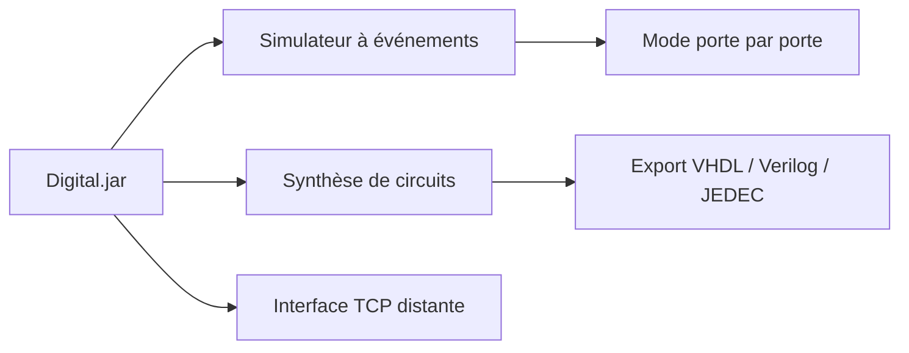

# hneemann/Digital

> Simulateur de logique numérique pour l'enseignement, avec export vers VHDL, Verilog et FPGA.

## Le problème
Apprendre la conception de circuits logiques demande un outil clair, qui montre les oscillations et teste les montages.

## Ce que ça fait vraiment
Il simule des circuits avec un mode porte par porte, des graphes de signaux et des tests intégrés. Il analyse et synthétise des circuits combinatoires et séquentiels, édite des automates, exporte en VHDL, Verilog et JEDEC (GAL) et en SVG. Une interface TCP permet de piloter le simulateur depuis un IDE d'assembleur.

## Comment c'est branché

Schéma simplifié d'après la fiche, sans diagramme fourni.

## Essayer
```bash
java -jar Digital.jar
mvn install
```

## Coût et pièges
Gratuit. Un Java Runtime (JRE 8 ou plus) est nécessaire, hors liste de prérequis. VHDL et Verilog demandent ghdl et Icarus Verilog installés à part. Licence GPL-3.0.

## Ce que ce n'est pas
Ce n'est pas un outil de synthèse FPGA complet : la synthèse HDL reste externe. Pas un outil pour la production industrielle.

## Alternatives
- Logisim-evolution : ajoute export VHDL/Verilog et intégration de cartes FPGA.
- Logisim (Carl Burch, ou ses forks) : l'outil dont Digital s'inspire.

## Pour toi
À ignorer : simulateur d'électronique pédagogique, sans lien avec un travail data / IA / MLOps.

