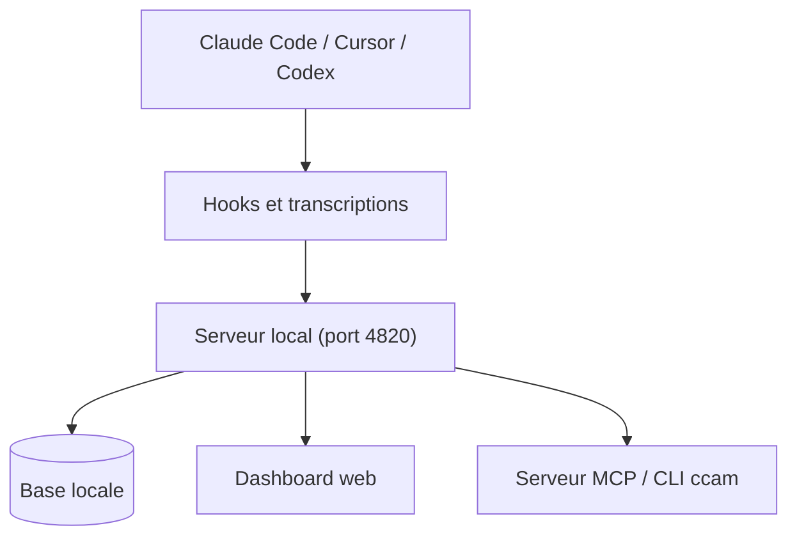

# hoangsonww/Claude-Code-Agent-Monitor

> Local dashboard to track sessions, tools and costs of Claude Code, Cursor and Codex.

## The problem
There is no single place to see what several coding agents are doing, how much they cost and how they are orchestrated.

## What it actually does
Relies on native hooks and transcript discovery to display sessions, conversations, agent trees, token usage and estimated cost. Lets you launch or resume agents from the interface and inspect configuration, skills, hooks and MCP. Listens locally on `127.0.0.1` and does not send transcripts to a hosted service. Also provides a `ccam` CLI, an MCP server and plugins.

## How it is wired
Simplified diagram based on the fiche, no diagram supplied.



## Trying it
```bash
git clone https://github.com/hoangsonww/Claude-Code-Agent-Monitor.git
cd Claude-Code-Agent-Monitor
npm run setup
npm run dev
# production : npm run build && npm start
```

## Cost and gotchas
Free; Node.js 22.22 minimum. The displayed cost is an API-equivalent estimate, not a bill.

## What it is not
Not an LLM observability tool for applications: it monitors coding agents on a workstation. Outside the local loop, access must be protected by a token.

## Alternatives
No alternative named in the README.

## For you
Watch: useful if you use several coding agents and want to track cost and orchestration, otherwise superfluous.
