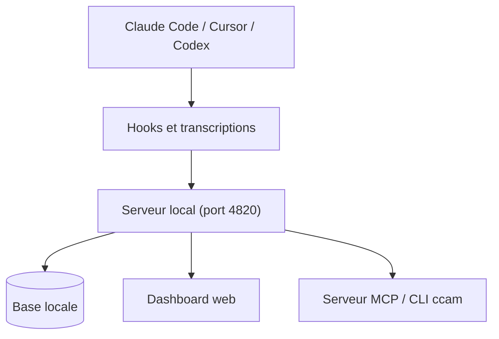

# hoangsonww/Claude-Code-Agent-Monitor

> Tableau de bord local pour suivre sessions, outils et coûts de Claude Code, Cursor et Codex.

## Le problème
Impossible de voir en un endroit ce que font plusieurs agents de code, combien ils coûtent et comment ils s'orchestrent.

## Ce que ça fait vraiment
S'appuie sur les hooks natifs et la découverte des transcriptions pour afficher sessions, conversations, arbres d'agents, usage de tokens et coût estimé. Permet de lancer ou reprendre des agents depuis l'interface et d'inspecter configuration, skills, hooks et MCP. Écoute en local sur `127.0.0.1` et n'envoie pas les transcriptions à un service hébergé. Fournit aussi une CLI `ccam`, un serveur MCP et des plugins.

## Comment c'est branché
Schéma simplifié d'après la fiche, sans diagramme fourni.



## Essayer
```bash
git clone https://github.com/hoangsonww/Claude-Code-Agent-Monitor.git
cd Claude-Code-Agent-Monitor
npm run setup
npm run dev
# production : npm run build && npm start
```

## Coût et pièges
Gratuit ; Node.js 22.22 minimum. Le coût affiché est une estimation équivalente API, pas une facture.

## Ce que ce n'est pas
Pas un outil d'observabilité LLM pour applications : il surveille des agents de code en poste de travail. Hors boucle locale, l'accès doit être protégé par jeton.

## Alternatives
Aucune alternative nommée dans le README.

## Pour toi
À surveiller : utile si tu utilises plusieurs agents de code et veux suivre coût et orchestration, sinon superflu.

