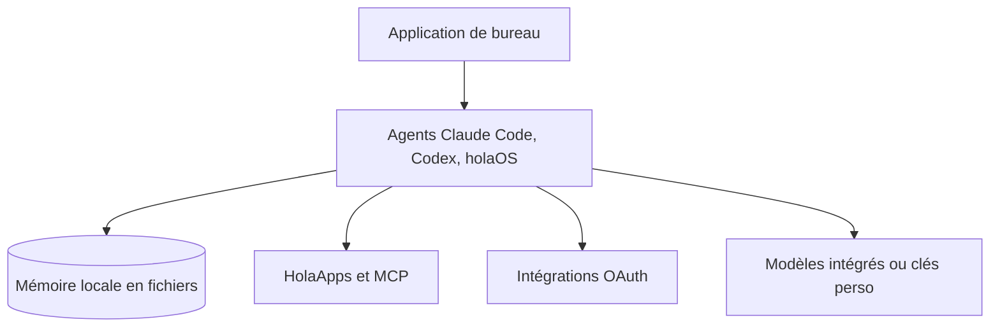

# holaboss-ai/holaOS

> Local workspace where agents drive your tools, applications and team chats.

## The problem
Agents arrive as closed products: hard to plug into your own tools, memory and conversations.

## What it actually does
Desktop application (Electron) that runs Claude Code, Codex or its in-house agent side by side, with a shared memory in local files. Adds apps in an internal marketplace, OAuth integrations, MCP servers, a driven browser, scheduled tasks and a recipe platform (HolaHub).

## How it is wired
No diagram provided. Diagram drawn from the README:


## Trying it
```bash
curl -fsSL https://raw.githubusercontent.com/holaboss-ai/holaOS/refs/heads/main/scripts/install.sh | bash -s -- --launch
npm run desktop:install
cp apps/desktop/.env.example apps/desktop/.env
npm run desktop:prepare-runtime:local
npm run desktop:dev
```

## Cost and gotchas
Built-in models via a holaOS account and plan; your own keys are possible. Read the installation script before running it.

## What it is not
"Local-first", but the default models go through the holaOS account. License described as "modified Apache 2.0" and not identified by GitHub. The privacy claims are not verified.

## Alternatives
None named in the README.

## For you
Watch: interesting to see a shared agent memory kept locally, but modified license and dependence on an account for the default models.
