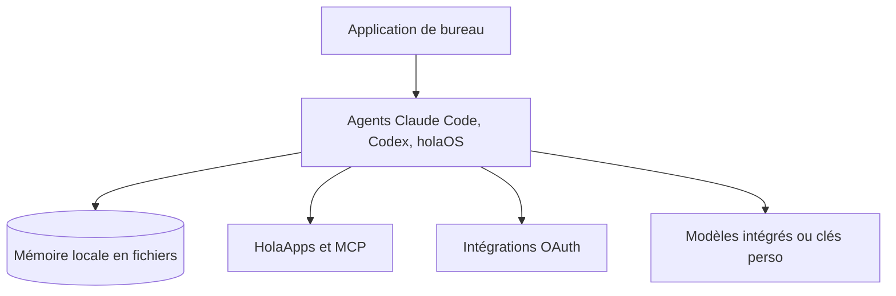

# holaboss-ai/holaOS

> Espace de travail local où des agents pilotent tes outils, applications et chats d'équipe.

## Le problème
Les agents arrivent en produit fermé : difficile de les brancher sur ses propres outils, mémoire et conversations.

## Ce que ça fait vraiment
Application de bureau (Electron) qui fait tourner Claude Code, Codex ou son agent maison côte à côte, avec une mémoire partagée en fichiers locaux. Ajoute des apps dans un marché interne, des intégrations OAuth, des serveurs MCP, un navigateur piloté, des tâches planifiées et une plateforme de recettes (HolaHub).

## Comment c'est branché
Pas de diagramme fourni. Schéma tiré du README :


## Essayer
```bash
curl -fsSL https://raw.githubusercontent.com/holaboss-ai/holaOS/refs/heads/main/scripts/install.sh | bash -s -- --launch
npm run desktop:install
cp apps/desktop/.env.example apps/desktop/.env
npm run desktop:prepare-runtime:local
npm run desktop:dev
```

## Coût et pièges
Modèles intégrés via un compte et un forfait holaOS ; clés perso possibles. Le script d'installation est à lire avant de l'exécuter.

## Ce que ce n'est pas
« Local-first » mais les modèles par défaut passent par le compte holaOS. Licence décrite comme « Apache 2.0 modifiée » et non identifiée par GitHub. Les allégations de confidentialité ne sont pas vérifiées.

## Alternatives
Aucune nommée dans le README.

## Pour toi
Surveiller : intéressant pour voir une mémoire d'agents partagée en local, mais licence modifiée et dépendance à un compte pour les modèles par défaut.

