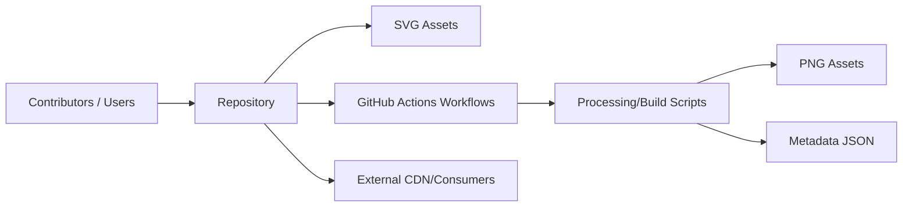

# homarr-labs/dashboard-icons

> Collection of over 1800 service icons for self-hosted dashboards, served via CDN.

## The problem
Finding consistent, well-formatted icons for each service on a dashboard (Plex, Nextcloud...) takes time.

## What it actually does
Icon repository with SVG (source), PNG and WEBP generated at 512 px, `-light` and `-dark` variants, kebab-case naming, JSON metadata. Python scripts and GitHub Actions convert, compress and validate contributions. Access through the dashboardicons.com site, an MCP server, or jsDelivr and raw GitHub. Submissions now go through a form on the site.

## How it is wired


## Trying it
```bash
curl -O https://cdn.jsdelivr.net/gh/homarr-labs/dashboard-icons/svg/nextcloud.svg
wget https://cdn.jsdelivr.net/gh/homarr-labs/dashboard-icons/svg/nextcloud.svg
```

## Cost and gotchas
Free. The brands represented remain subject to their owners' trademark rights, whatever the repository's license.

## What it is not
Not a generic (UI) icon library: only service logos. Not a right to use these brands beyond identification.

## Alternatives
- Simple Icons: collection indexed by the site, under CC0-1.0, with colorable variants.

## For you
Ignore for data/AI monitoring: a useful graphic resource for a homelab (Homarr, Homepage, Dashy), unrelated to your work.
